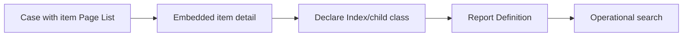

# Embedded page lists versus normalized child records

**PFA-080** | SSA/LSA engineering case | Design study, laboratory proof pending

## Production symptom and business risk

An insurance case includes 300 claim items. Developers store them as an embedded Page List, then introduce reporting by each item's product code. Reports become slow because operational queries must unnest BLOB-held structures.

The outcome must be provable across the case record, the data source and any cached or indexed read model. A green Flow Action is not a substitute for verifying where the authoritative state was committed.

## System sequence

## Pega components and design responsibilities

1. **Page List property.** Record the rule/class mapping, execution context, data owner and a measurable acceptance condition.
2. **Data Object.** Record the rule/class mapping, execution context, data owner and a measurable acceptance condition.
3. **Declare Index.** Record the rule/class mapping, execution context, data owner and a measurable acceptance condition.
4. **Report Definition.** Record the rule/class mapping, execution context, data owner and a measurable acceptance condition.
5. **case BLOB.** Record the rule/class mapping, execution context, data owner and a measurable acceptance condition.

## Architecture and implementation steps

1. Decide whether the child records are case-owned snapshots, separately modified entities or independent search rows.

2. If the list is small and read/written together, embedding can be appropriate; avoid normalization solely for theoretical elegance.

3. If items require cross-case search, update and history, model stable child keys and an index/child table with a clear consistency plan.

4. Test how parent saves change embedded list and index entries, including a failed transaction and concurrent updates.

5. Avoid duplicated copies of item values in several case areas without an explicit authoritative field.

A detailed implementation should name classes, property types, parameters, indexes and connector contracts for the chosen product release. Where sample names are needed, use domain-specific names, not copied vendor rules.

## Options and design decision

- **Option 1:** Embedded lists simplify flow state but make granular reporting difficult.
- **Option 2:** normalized child records support indexed search but add lifecycle and locking.

Evaluate cost under realistic result cardinality, transaction rate, retry load and permission changes. An optimized read path that violates ownership or consistency is not a valid optimization.

## Failure analysis

An item's product code changes but its index or copied snapshot is stale, returning inconsistent report results.

Collect source record IDs, case version, exact Data Page parameters or SQL query, node/requestor, rule stack and partner operation ID as applicable. Separate a stale cache/index result from a failed database write.

## Reproducible tests

1. **Scenario 1:** Search across cases by child product. Capture expected values and the actual committed/source state.
2. **Scenario 2:** edit one item while other remains unchanged. Capture expected values and the actual committed/source state.
3. **Scenario 3:** simulate parent save rollback. Capture expected values and the actual committed/source state.

No tests described here have yet been executed by this publication. Verify in a release-matched Pega sandbox with sanitized Clipboard, DBTrace, Tracer, integration logs and screenshots where applicable.

## Capacity, security and recovery

Document source-specific freshness and tenant isolation, peak query/request volume, failure backlog and a supportable recovery action. Retain historical case/audit integrity during migration and do not infer successful external transactions from a Pega commit alone.

## Pega technical reading

- [Data modeling](https://academy.pega.com/topic/data-modeling/v1)

*Independent design study with fictional scenario, not a report of production benchmarks.*
