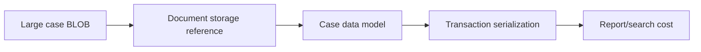

# Large BLOB storage and retrieval trade-offs

**PFA-081** | SSA/LSA engineering case | Design study, laboratory proof pending

## Production symptom and business risk

A claims app persists signed PDFs, external API responses and image metadata inside case BLOBs. Average case size grows rapidly and routine Flow Action saves serialize large data sets unrelated to the change.

The outcome must be provable across the case record, the data source and any cached or indexed read model. A green Flow Action is not a substitute for verifying where the authoritative state was committed.

## System sequence

## Pega components and design responsibilities

1. **pyWorkPage.** Record the rule/class mapping, execution context, data owner and a measurable acceptance condition.
2. **attachment repository.** Record the rule/class mapping, execution context, data owner and a measurable acceptance condition.
3. **case BLOB.** Record the rule/class mapping, execution context, data owner and a measurable acceptance condition.
4. **Data Page.** Record the rule/class mapping, execution context, data owner and a measurable acceptance condition.
5. **content metadata.** Record the rule/class mapping, execution context, data owner and a measurable acceptance condition.

## Architecture and implementation steps

1. Identify which fields are essential for case audit and which are external payloads or binary documents that can be referenced.

2. Store attachments in an appropriate document repository with stable IDs, checksum and access rules; keep only required metadata and references in work data.

3. Trim connector responses to purpose-specific Data Objects rather than persisting full request/response bodies.

4. Measure case-save elapsed, DB row size and memory for worst-case persisted records.

5. Define backfill and purge plan for already bloated cases, preserving legal holds and references.

A detailed implementation should name classes, property types, parameters, indexes and connector contracts for the chosen product release. Where sample names are needed, use domain-specific names, not copied vendor rules.

## Options and design decision

- **Option 1:** Everything in BLOB is easy to code but expensive to save.
- **Option 2:** external content storage reduces case size but needs reference integrity.

Evaluate cost under realistic result cardinality, transaction rate, retry load and permission changes. An optimized read path that violates ownership or consistency is not a valid optimization.

## Failure analysis

A case save changes one text field but reserializes large nested payloads and stalls. A purge removes a BLOB reference before external document deletion.

Collect source record IDs, case version, exact Data Page parameters or SQL query, node/requestor, rule stack and partner operation ID as applicable. Separate a stale cache/index result from a failed database write.

## Reproducible tests

1. **Scenario 1:** Measure save time at 1MB and 20MB case shapes. Capture expected values and the actual committed/source state.
2. **Scenario 2:** restore attachment after archive. Capture expected values and the actual committed/source state.
3. **Scenario 3:** check unauthorized direct download. Capture expected values and the actual committed/source state.

No tests described here have yet been executed by this publication. Verify in a release-matched Pega sandbox with sanitized Clipboard, DBTrace, Tracer, integration logs and screenshots where applicable.

## Capacity, security and recovery

Document source-specific freshness and tenant isolation, peak query/request volume, failure backlog and a supportable recovery action. Retain historical case/audit integrity during migration and do not infer successful external transactions from a Pega commit alone.

## Pega technical reading

- [Data storage](https://academy.pega.com/topic/data-modeling/v1)

*Independent design study with fictional scenario, not a report of production benchmarks.*
