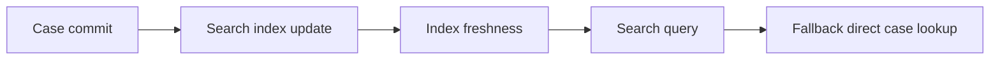

# Search index consistency in time-critical screens

**PFA-082** | SSA/LSA engineering case | Design study, laboratory proof pending

## Production symptom and business risk

A new case is committed to the operational database, but a user searching by its reference seconds later cannot find it in an indexed global search. Support treats the missing result as evidence the case failed to save.

The outcome must be provable across the case record, the data source and any cached or indexed read model. A green Flow Action is not a substitute for verifying where the authoritative state was committed.

## System sequence

## Pega components and design responsibilities

1. **Case search.** Record the rule/class mapping, execution context, data owner and a measurable acceptance condition.
2. **Pega Search Index.** Record the rule/class mapping, execution context, data owner and a measurable acceptance condition.
3. **case ID.** Record the rule/class mapping, execution context, data owner and a measurable acceptance condition.
4. **Report Definition.** Record the rule/class mapping, execution context, data owner and a measurable acceptance condition.
5. **data consistency.** Record the rule/class mapping, execution context, data owner and a measurable acceptance condition.

## Architecture and implementation steps

1. Define if the journey needs read-after-write certainty or only eventual search discoverability.

2. Use the committed case ID to navigate immediately after creation rather than depending on index refresh speed.

3. Capture index update latency and error signals; a missing result could be indexing lag, permission filtering or failed save.

4. Use direct supported case lookup for critical confirmation and keep search as discovery rather than a transaction acknowledgment.

5. Test indexing under bulk case creation and document the maximum expected discoverability delay.

A detailed implementation should name classes, property types, parameters, indexes and connector contracts for the chosen product release. Where sample names are needed, use domain-specific names, not copied vendor rules.

## Options and design decision

- **Option 1:** Search index scales discovery but may lag.
- **Option 2:** direct ID lookup confirms persistence but requires an ID and authorization.

Evaluate cost under realistic result cardinality, transaction rate, retry load and permission changes. An optimized read path that violates ownership or consistency is not a valid optimization.

## Failure analysis

A newly created case appears absent from search and the user submits it again, creating duplicates; direct case ID would have prevented this.

Collect source record IDs, case version, exact Data Page parameters or SQL query, node/requestor, rule stack and partner operation ID as applicable. Separate a stale cache/index result from a failed database write.

## Reproducible tests

1. **Scenario 1:** Create and immediately search. Capture expected values and the actual committed/source state.
2. **Scenario 2:** throttle index processing. Capture expected values and the actual committed/source state.
3. **Scenario 3:** compare authorized direct lookup to search results. Capture expected values and the actual committed/source state.

No tests described here have yet been executed by this publication. Verify in a release-matched Pega sandbox with sanitized Clipboard, DBTrace, Tracer, integration logs and screenshots where applicable.

## Capacity, security and recovery

Document source-specific freshness and tenant isolation, peak query/request volume, failure backlog and a supportable recovery action. Retain historical case/audit integrity during migration and do not infer successful external transactions from a Pega commit alone.

## Pega technical reading

- [Case life cycle](https://academy.pega.com/topic/case-lifecycle/v7)

*Independent design study with fictional scenario, not a report of production benchmarks.*
