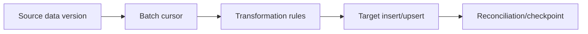

# Batch data migration while active cases continue

**PFA-083** | SSA/LSA engineering case | Design study, laboratory proof pending

## Production symptom and business risk

A migration moves millions of archived policy records into new data classes while customer agents still update active cases. A one-time unbounded batch locks tables, and records change between extraction and insertion.

The outcome must be provable across the case record, the data source and any cached or indexed read model. A green Flow Action is not a substitute for verifying where the authoritative state was committed.

## System sequence

## Pega components and design responsibilities

1. **Data Transform.** Record the rule/class mapping, execution context, data owner and a measurable acceptance condition.
2. **Job Scheduler.** Record the rule/class mapping, execution context, data owner and a measurable acceptance condition.
3. **Data classes.** Record the rule/class mapping, execution context, data owner and a measurable acceptance condition.
4. **Report Definition.** Record the rule/class mapping, execution context, data owner and a measurable acceptance condition.
5. **data migration ledger.** Record the rule/class mapping, execution context, data owner and a measurable acceptance condition.

## Architecture and implementation steps

1. Define immutable business identity, conflict ownership and what happens to updates arriving during migration.

2. Extract in bounded stable pages or a watermark that remains correct under concurrent inserts.

3. Write idempotent upserts and persist source version plus transformation version for traceability.

4. Reconcile record counts, financial totals and sampled key attributes rather than treating matching row counts as enough.

5. Switch readers only after compatibility tests and an explicit cutover window with fallback.

A detailed implementation should name classes, property types, parameters, indexes and connector contracts for the chosen product release. Where sample names are needed, use domain-specific names, not copied vendor rules.

## Options and design decision

- **Option 1:** Big-bang copy is simple but blocks writes.
- **Option 2:** incremental migration reduces downtime but needs change-capture or reconciliation.

Evaluate cost under realistic result cardinality, transaction rate, retry load and permission changes. An optimized read path that violates ownership or consistency is not a valid optimization.

## Failure analysis

A row changes after extraction; target shows stale status. Restarting batch without stable keys duplicates rows.

Collect source record IDs, case version, exact Data Page parameters or SQL query, node/requestor, rule stack and partner operation ID as applicable. Separate a stale cache/index result from a failed database write.

## Reproducible tests

1. **Scenario 1:** Stop migration halfway and resume. Capture expected values and the actual committed/source state.
2. **Scenario 2:** edit source mid-flight. Capture expected values and the actual committed/source state.
3. **Scenario 3:** reconcile financial total and missed records. Capture expected values and the actual committed/source state.

No tests described here have yet been executed by this publication. Verify in a release-matched Pega sandbox with sanitized Clipboard, DBTrace, Tracer, integration logs and screenshots where applicable.

## Capacity, security and recovery

Document source-specific freshness and tenant isolation, peak query/request volume, failure backlog and a supportable recovery action. Retain historical case/audit integrity during migration and do not infer successful external transactions from a Pega commit alone.

## Pega technical reading

- [Data storage](https://academy.pega.com/topic/data-modeling/v1)

*Independent design study with fictional scenario, not a report of production benchmarks.*
