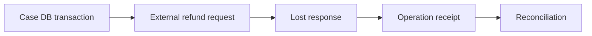

# Database transactions across case and API boundaries

**PFA-084** | SSA/LSA engineering case | Design study, laboratory proof pending

## Production symptom and business risk

A Flow Action saves a case and issues a refund to an external payment processor. The external payment commits before the Pega DB save fails. The workflow retries the connector and creates another refund.

The outcome must be provable across the case record, the data source and any cached or indexed read model. A green Flow Action is not a substitute for verifying where the authoritative state was committed.

## System sequence

## Pega components and design responsibilities

1. **Commit/rollback boundaries.** Record the rule/class mapping, execution context, data owner and a measurable acceptance condition.
2. **Connect REST.** Record the rule/class mapping, execution context, data owner and a measurable acceptance condition.
3. **Queue Processor.** Record the rule/class mapping, execution context, data owner and a measurable acceptance condition.
4. **case status.** Record the rule/class mapping, execution context, data owner and a measurable acceptance condition.
5. **idempotency ledger.** Record the rule/class mapping, execution context, data owner and a measurable acceptance condition.

## Architecture and implementation steps

1. Map each local commit boundary and any external side effect; they do not share a single Pega database transaction by default.

2. Persist a stable refund operation ID before dispatch, with an explicit Pending status and authorization decision.

3. Require external idempotency or a status-lookup API; never invent a new payment identity simply because an HTTP response was lost.

4. On retry, recheck current case status and previously observed receipt before calling the payment processor.

5. Define compensation for a genuine incorrect refund only where the business and partner support it.

A detailed implementation should name classes, property types, parameters, indexes and connector contracts for the chosen product release. Where sample names are needed, use domain-specific names, not copied vendor rules.

## Options and design decision

- **Option 1:** Synchronous payout is convenient but couples response and side effect.
- **Option 2:** queued payout decouples UI yet requires pending/reconciliation semantics.

Evaluate cost under realistic result cardinality, transaction rate, retry load and permission changes. An optimized read path that violates ownership or consistency is not a valid optimization.

## Failure analysis

A rolled-back Pega transaction cannot roll back money already paid remotely; a duplicate queue delivery may repeat side effects.

Collect source record IDs, case version, exact Data Page parameters or SQL query, node/requestor, rule stack and partner operation ID as applicable. Separate a stale cache/index result from a failed database write.

## Reproducible tests

1. **Scenario 1:** Drop remote HTTP response after payout. Capture expected values and the actual committed/source state.
2. **Scenario 2:** force DB save error. Capture expected values and the actual committed/source state.
3. **Scenario 3:** retry with same key and verify one refund. Capture expected values and the actual committed/source state.

No tests described here have yet been executed by this publication. Verify in a release-matched Pega sandbox with sanitized Clipboard, DBTrace, Tracer, integration logs and screenshots where applicable.

## Capacity, security and recovery

Document source-specific freshness and tenant isolation, peak query/request volume, failure backlog and a supportable recovery action. Retain historical case/audit integrity during migration and do not infer successful external transactions from a Pega commit alone.

## Pega technical reading

- [Queue processors](https://academy.pega.com/topic/queue-processors-and-job-schedulers/v2)

*Independent design study with fictional scenario, not a report of production benchmarks.*
