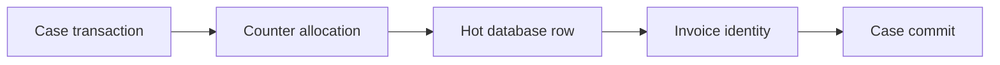

# Dealing with hotspot rows in shared business counters

**PFA-085** | SSA/LSA engineering case | Design study, laboratory proof pending

## Production symptom and business risk

An enterprise application generates sequential invoice numbers by reading and incrementing a shared Counter record inside every case flow. During peak hours hundreds of requests contend for one database row and response time climbs.

The outcome must be provable across the case record, the data source and any cached or indexed read model. A green Flow Action is not a substitute for verifying where the authoritative state was committed.

## System sequence

## Pega components and design responsibilities

1. **Data class for counter.** Record the rule/class mapping, execution context, data owner and a measurable acceptance condition.
2. **Report Definition.** Record the rule/class mapping, execution context, data owner and a measurable acceptance condition.
3. **case commit.** Record the rule/class mapping, execution context, data owner and a measurable acceptance condition.
4. **locking.** Record the rule/class mapping, execution context, data owner and a measurable acceptance condition.
5. **sequence service.** Record the rule/class mapping, execution context, data owner and a measurable acceptance condition.

## Architecture and implementation steps

1. Define whether gapless numbering is legally required; most businesses need unique auditable numbers, not necessarily contiguous integers.

2. Prefer an authoritative sequence allocator or external numbering service with concurrency guarantees rather than read-then-write logic on one shared row.

3. Reserve blocks only when gaps and reconciliation are permitted, recording reserved and consumed ranges.

4. Keep invoice identity allocation separate from slow partner checks to avoid long-lived counter locks.

5. Load test peak issuance and node failover, measuring lock wait distribution and missing/duplicate numbers.

A detailed implementation should name classes, property types, parameters, indexes and connector contracts for the chosen product release. Where sample names are needed, use domain-specific names, not copied vendor rules.

## Options and design decision

- **Option 1:** Single counter row is simple but hotspot.
- **Option 2:** partitioned or database sequence scales but may create gaps.

Evaluate cost under realistic result cardinality, transaction rate, retry load and permission changes. An optimized read path that violates ownership or consistency is not a valid optimization.

## Failure analysis

Two requests read same old number before lock is acquired, producing collision, or transaction rollback creates a missing reserved value.

Collect source record IDs, case version, exact Data Page parameters or SQL query, node/requestor, rule stack and partner operation ID as applicable. Separate a stale cache/index result from a failed database write.

## Reproducible tests

1. **Scenario 1:** Run 500 parallel creates. Capture expected values and the actual committed/source state.
2. **Scenario 2:** kill allocator after reservation. Capture expected values and the actual committed/source state.
3. **Scenario 3:** assert uniqueness and audit of gaps. Capture expected values and the actual committed/source state.

No tests described here have yet been executed by this publication. Verify in a release-matched Pega sandbox with sanitized Clipboard, DBTrace, Tracer, integration logs and screenshots where applicable.

## Capacity, security and recovery

Document source-specific freshness and tenant isolation, peak query/request volume, failure backlog and a supportable recovery action. Retain historical case/audit integrity during migration and do not infer successful external transactions from a Pega commit alone.

## Pega technical reading

- [Data storage](https://academy.pega.com/topic/data-modeling/v1)

*Independent design study with fictional scenario, not a report of production benchmarks.*
