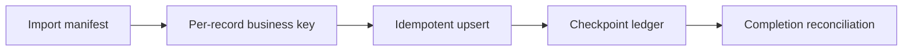

# Reconciliation after partial data import failures

**PFA-086** | SSA/LSA engineering case | Design study, laboratory proof pending

## Production symptom and business risk

A batch imports 30,000 supplier records. The first 20,000 succeed before the partner API fails. An operator restarts the whole import, creating duplicates and corrupting aggregate reconciliation totals.

The outcome must be provable across the case record, the data source and any cached or indexed read model. A green Flow Action is not a substitute for verifying where the authoritative state was committed.

## System sequence

## Pega components and design responsibilities

1. **Job Scheduler.** Record the rule/class mapping, execution context, data owner and a measurable acceptance condition.
2. **Queue Processor.** Record the rule/class mapping, execution context, data owner and a measurable acceptance condition.
3. **Data Transform.** Record the rule/class mapping, execution context, data owner and a measurable acceptance condition.
4. **Data Page.** Record the rule/class mapping, execution context, data owner and a measurable acceptance condition.
5. **import receipt class.** Record the rule/class mapping, execution context, data owner and a measurable acceptance condition.

## Architecture and implementation steps

1. Assign immutable import ID and stable per-record source key before processing begins.

2. Validate and stage source records separately from writing final Pega data, including schema and class mapping checks.

3. Persist a per-record ledger with status, source version, error category and transformation version.

4. Retry only eligible failed or unconfirmed records with idempotent writes; do not reset all records to Pending on restart.

5. Reconcile keys and financial totals plus error categories; a job-level Success does not prove complete data quality.

A detailed implementation should name classes, property types, parameters, indexes and connector contracts for the chosen product release. Where sample names are needed, use domain-specific names, not copied vendor rules.

## Options and design decision

- **Option 1:** One large transaction is all-or-nothing but impractical for huge imports.
- **Option 2:** per-item checkpointing scales with repair responsibility.

Evaluate cost under realistic result cardinality, transaction rate, retry load and permission changes. An optimized read path that violates ownership or consistency is not a valid optimization.

## Failure analysis

A network timeout after upsert causes retry duplicates if source key is not unique; partial result can masquerade as full completion.

Collect source record IDs, case version, exact Data Page parameters or SQL query, node/requestor, rule stack and partner operation ID as applicable. Separate a stale cache/index result from a failed database write.

## Reproducible tests

1. **Scenario 1:** Stop at 20001st item. Capture expected values and the actual committed/source state.
2. **Scenario 2:** restart and verify no duplicates. Capture expected values and the actual committed/source state.
3. **Scenario 3:** change source row version mid-run. Capture expected values and the actual committed/source state.

No tests described here have yet been executed by this publication. Verify in a release-matched Pega sandbox with sanitized Clipboard, DBTrace, Tracer, integration logs and screenshots where applicable.

## Capacity, security and recovery

Document source-specific freshness and tenant isolation, peak query/request volume, failure backlog and a supportable recovery action. Retain historical case/audit integrity during migration and do not infer successful external transactions from a Pega commit alone.

## Pega technical reading

- [Queue processors](https://academy.pega.com/topic/queue-processors-and-job-schedulers/v2)

*Independent design study with fictional scenario, not a report of production benchmarks.*
