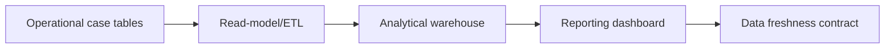

# Reporting warehouses versus operational reports

**PFA-087** | Pega Lead System Architect study | Lab verification pending

## Business situation

Executives want daily regulatory exposure trends, while operators need an accurate case worklist to make real-time assignments. A team runs dozens of massive analytics joins on the operational Pega case database during contact-centre hours, increasing lock waits and response times.

The engineering objective is to prove a bounded, authorized and recoverable transaction. A response from an interface or query is useful evidence but not, by itself, proof that a remote effect and Pega case state were committed as one unit.

## Proposed processing design

## Relevant Pega rules and interfaces

1. **Report Definition:** record real class/ruleset, source system, trusted principal and support responsibility for this component.
2. **Pega DB:** record real class/ruleset, source system, trusted principal and support responsibility for this component.
3. **data export/ETL:** record real class/ruleset, source system, trusted principal and support responsibility for this component.
4. **case search:** record real class/ruleset, source system, trusted principal and support responsibility for this component.
5. **analytics contract:** record real class/ruleset, source system, trusted principal and support responsibility for this component.

## Detailed implementation decisions

1. Classify reports as transactional, near-real-time operational, or historical analytical. Their data freshness and audit requirements differ.

2. Keep small indexed worklist reports on the operational source where current assignment ownership matters.

3. Move large trend/aggregate workloads to a governed reporting warehouse with incremental loading and reconciliation.

4. Carry case ID, source version and source-as-of timestamp through the reporting pipeline so consumers understand lag.

5. Measure replication delay, row reconciliation and access policy across both environments; a warehouse is not a security-free copy.

Before coding, create a lightweight interface specification containing endpoint or source, message/record identity, required fields, timeout/consistency objective and expected behavior for missing or duplicated information.

## Design alternatives

- **Pattern 1:** Operational reporting is fresh but can contend with work.
- **Pattern 2:** warehouse analytics scales heavy queries but requires lag and retention governance.

The ADR should identify which requirement would fail under the rejected pattern and how the selected design handles both slow and unavailable dependencies.

## Failure scenario to diagnose

A warehouse snapshot shows a customer complaint as Open after the case has resolved. A compliance report without source-as-of time becomes misleading.

Use Pega Tracer, PAL, DBTrace and service-side request/receipt logs when relevant. Reconcile case ID with external operation ID and event/version so a retry is not accidentally interpreted as a new business command.

## Acceptance tests

1. **Controlled test 1:** Compare assignment queue to live DB. Capture the committed state, error type, elapsed time and whether any remote effect occurred.
2. **Controlled test 2:** measure warehouse lag after bulk update. Capture the committed state, error type, elapsed time and whether any remote effect occurred.
3. **Controlled test 3:** reconcile daily financial totals. Capture the committed state, error type, elapsed time and whether any remote effect occurred.

These are test instructions. No benchmarks, live screenshots or successful lab outcomes have been fabricated. A validated edition must state its Pega release and retain sanitized configuration evidence.

## Production runbook requirements

Specify who can replay failed actions, the expiry time for unresolved outcomes, backpressure or throttling limits and a repair path. For reporting and data retention, verify authorization, point-in-time interpretation and historical evidence as well as throughput. For integrations, distinguish callback acceptance from final business completion.

## Primary reading

- [Pega Academy: Data modeling](https://academy.pega.com/topic/data-modeling/v1)

*Independent architectural reference using fictional examples. Version-sensitive details should be rechecked against the deployed release.*
