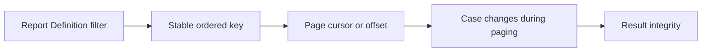

# Pagination for million-row data sets

**PFA-088** | Pega Lead System Architect study | Lab verification pending

## Business situation

A Pega worklist report exposes one million cases, ordered by LastUpdated. The UI paginates using offsets while cases continue to update. Operators see duplicates on the second page and occasionally miss rows entirely.

The engineering objective is to prove a bounded, authorized and recoverable transaction. A response from an interface or query is useful evidence but not, by itself, proof that a remote effect and Pega case state were committed as one unit.

## Proposed processing design

## Relevant Pega rules and interfaces

1. **Report Definition:** record real class/ruleset, source system, trusted principal and support responsibility for this component.
2. **stable sorting:** record real class/ruleset, source system, trusted principal and support responsibility for this component.
3. **Data Page:** record real class/ruleset, source system, trusted principal and support responsibility for this component.
4. **case ID:** record real class/ruleset, source system, trusted principal and support responsibility for this component.
5. **database query plan:** record real class/ruleset, source system, trusted principal and support responsibility for this component.

## Detailed implementation decisions

1. Specify whether pagination is for browsing a moving operational queue or exporting an immutable snapshot; the two require different consistency guarantees.

2. Order by a deterministic compound key such as UpdatedAt plus unique case ID, avoiding ties that reorder between requests.

3. For deep paging, evaluate a keyset/cursor-style retrieval where supported by the data source rather than large-offset scans.

4. Use bounded page size and selective filtering to prevent scanning and sorting the full million-row result for every screen.

5. Test concurrent inserts and updates during navigation and decide whether a refreshed queue or immutable export is the correct user journey.

Before coding, create a lightweight interface specification containing endpoint or source, message/record identity, required fields, timeout/consistency objective and expected behavior for missing or duplicated information.

## Design alternatives

- **Pattern 1:** Offset paging is straightforward but expensive/dependent on moving rows.
- **Pattern 2:** cursor paging handles large sequential traversal but needs stable ordering.

The ADR should identify which requirement would fail under the rejected pattern and how the selected design handles both slow and unavailable dependencies.

## Failure scenario to diagnose

An updated case moves from page 3 to page 1 between page requests and is counted twice or never seen. A large COUNT can dominate even first-page latency.

Use Pega Tracer, PAL, DBTrace and service-side request/receipt logs when relevant. Reconcile case ID with external operation ID and event/version so a retry is not accidentally interpreted as a new business command.

## Acceptance tests

1. **Controlled test 1:** Page while cases update. Capture the committed state, error type, elapsed time and whether any remote effect occurred.
2. **Controlled test 2:** compare offset 100k to cursor retrieval. Capture the committed state, error type, elapsed time and whether any remote effect occurred.
3. **Controlled test 3:** exercise equal timestamps. Capture the committed state, error type, elapsed time and whether any remote effect occurred.

These are test instructions. No benchmarks, live screenshots or successful lab outcomes have been fabricated. A validated edition must state its Pega release and retain sanitized configuration evidence.

## Production runbook requirements

Specify who can replay failed actions, the expiry time for unresolved outcomes, backpressure or throttling limits and a repair path. For reporting and data retention, verify authorization, point-in-time interpretation and historical evidence as well as throughput. For integrations, distinguish callback acceptance from final business completion.

## Primary reading

- [Pega Academy: Data modeling](https://academy.pega.com/topic/data-modeling/v1)

*Independent architectural reference using fictional examples. Version-sensitive details should be rechecked against the deployed release.*
