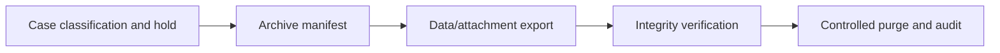

# Purging cases without erasing required audit evidence

**PFA-089** | Pega Lead System Architect study | Lab verification pending

## Business situation

A claims programme purges resolved cases after five years to reduce database cost. Some cases have active legal holds and supporting documents in external storage. Removing case records without synchronizing attachments and audit evidence breaches retention obligations.

The engineering objective is to prove a bounded, authorized and recoverable transaction. A response from an interface or query is useful evidence but not, by itself, proof that a remote effect and Pega case state were committed as one unit.

## Proposed processing design

## Relevant Pega rules and interfaces

1. **Case history:** record real class/ruleset, source system, trusted principal and support responsibility for this component.
2. **attachment metadata:** record real class/ruleset, source system, trusted principal and support responsibility for this component.
3. **retention rules:** record real class/ruleset, source system, trusted principal and support responsibility for this component.
4. **Job Scheduler:** record real class/ruleset, source system, trusted principal and support responsibility for this component.
5. **external archive:** record real class/ruleset, source system, trusted principal and support responsibility for this component.

## Detailed implementation decisions

1. Identify retention authority per jurisdiction and case type, including legal hold, regulatory evidence and legitimate deletion windows.

2. Keep a manifest of case IDs, version, documents, decision history and checksum before removing source records.

3. Validate archive readability, entitlement and content references with a sample restoration exercise.

4. Run purge in bounded batches and record deletion receipts; do not rely on one unbounded DELETE affecting all cases.

5. Ensure search and support distinguish archived evidence from live active cases without exposing retained data to unauthorized users.

Before coding, create a lightweight interface specification containing endpoint or source, message/record identity, required fields, timeout/consistency objective and expected behavior for missing or duplicated information.

## Design alternatives

- **Pattern 1:** Indefinite retention simplifies legal evidence but increases privacy/storage burden.
- **Pattern 2:** archive-and-purge balances needs with more governance.

The ADR should identify which requirement would fail under the rejected pattern and how the selected design handles both slow and unavailable dependencies.

## Failure scenario to diagnose

Attachment metadata is purged while the file remains indefinitely accessible, or the case is deleted before external document archive completes.

Use Pega Tracer, PAL, DBTrace and service-side request/receipt logs when relevant. Reconcile case ID with external operation ID and event/version so a retry is not accidentally interpreted as a new business command.

## Acceptance tests

1. **Controlled test 1:** Apply legal hold to otherwise expired case. Capture the committed state, error type, elapsed time and whether any remote effect occurred.
2. **Controlled test 2:** restore archived case evidence. Capture the committed state, error type, elapsed time and whether any remote effect occurred.
3. **Controlled test 3:** run purge twice idempotently. Capture the committed state, error type, elapsed time and whether any remote effect occurred.

These are test instructions. No benchmarks, live screenshots or successful lab outcomes have been fabricated. A validated edition must state its Pega release and retain sanitized configuration evidence.

## Production runbook requirements

Specify who can replay failed actions, the expiry time for unresolved outcomes, backpressure or throttling limits and a repair path. For reporting and data retention, verify authorization, point-in-time interpretation and historical evidence as well as throughput. For integrations, distinguish callback acceptance from final business completion.

## Primary reading

- [Pega Academy: Case life cycle](https://academy.pega.com/topic/case-lifecycle/v7)

*Independent architectural reference using fictional examples. Version-sensitive details should be rechecked against the deployed release.*
