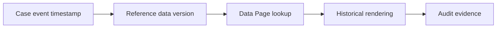

# Managing reference data versioning across releases

**PFA-090** | Pega Lead System Architect study | Lab verification pending

## Business situation

An application uses a public list of payment status codes that changes every quarter. Code 07 meant Pending last year but now means Investigating. Historical case reports display the current label and misrepresent past decisions.

The engineering objective is to prove a bounded, authorized and recoverable transaction. A response from an interface or query is useful evidence but not, by itself, proof that a remote effect and Pega case state were committed as one unit.

## Proposed processing design

## Relevant Pega rules and interfaces

1. **Reference Data class:** record real class/ruleset, source system, trusted principal and support responsibility for this component.
2. **Node-scoped Data Page:** record real class/ruleset, source system, trusted principal and support responsibility for this component.
3. **effective-date lookup:** record real class/ruleset, source system, trusted principal and support responsibility for this component.
4. **case history:** record real class/ruleset, source system, trusted principal and support responsibility for this component.
5. **Report Definition:** record real class/ruleset, source system, trusted principal and support responsibility for this component.

## Detailed implementation decisions

1. Distinguish reference codes that are immutable from labels or policies whose meaning changes over time.

2. Assign version or valid-from/valid-to dates to reference data when historical interpretation is required.

3. Persist the rule/code version or selected label snapshot with an important business decision if regulations require point-in-time evidence.

4. Cache only one effective reference version where semantics allow; Data Page refresh must account for effective-date changes.

5. Test old cases after adding a new code version and ensure reports show the correct historical meaning.

Before coding, create a lightweight interface specification containing endpoint or source, message/record identity, required fields, timeout/consistency objective and expected behavior for missing or duplicated information.

## Design alternatives

- **Pattern 1:** Current-reference lookup simplifies UI but rewrites history.
- **Pattern 2:** versioned reference records preserve audit at increased modeling cost.

The ADR should identify which requirement would fail under the rejected pattern and how the selected design handles both slow and unavailable dependencies.

## Failure scenario to diagnose

A newly deployed code list changes the apparent outcome of an old claim without any case history event.

Use Pega Tracer, PAL, DBTrace and service-side request/receipt logs when relevant. Reconcile case ID with external operation ID and event/version so a retry is not accidentally interpreted as a new business command.

## Acceptance tests

1. **Controlled test 1:** Render case from prior year. Capture the committed state, error type, elapsed time and whether any remote effect occurred.
2. **Controlled test 2:** change label and rerun audit report. Capture the committed state, error type, elapsed time and whether any remote effect occurred.
3. **Controlled test 3:** test overlapping effective periods. Capture the committed state, error type, elapsed time and whether any remote effect occurred.

These are test instructions. No benchmarks, live screenshots or successful lab outcomes have been fabricated. A validated edition must state its Pega release and retain sanitized configuration evidence.

## Production runbook requirements

Specify who can replay failed actions, the expiry time for unresolved outcomes, backpressure or throttling limits and a repair path. For reporting and data retention, verify authorization, point-in-time interpretation and historical evidence as well as throughput. For integrations, distinguish callback acceptance from final business completion.

## Primary reading

- [Pega Academy: Data Pages](https://academy.pega.com/topic/data-pages/v5)

*Independent architectural reference using fictional examples. Version-sensitive details should be rechecked against the deployed release.*
