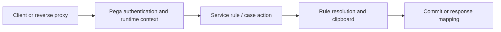

# Following a Pega Request: HTTP Entry, Requestor Context and Rule Execution

**PFA-001** | Technical design study for Pega Senior and Lead System Architects | Laboratory verification pending

## Architecture problem

An integration user calls a case service that works under a developer's login but fails under a service account. The team suspects network routing. Yet the HTTP request reaches Pega; the issue begins when authentication chooses the runtime context, which changes access rights and eligible rules. The architect must trace the request through authentication, execution and response rather than treating HTTP 200 as end-to-end success.

## System design

This diagram records a proposed boundary, not a fabricated Pega runtime screenshot. The interfaces and exact rule forms must be verified in a permitted sandbox.

## Feature inventory and design responsibilities

| Pega rule or component | Review requirement |
|---|---|
| Authentication Service / Service Package | Primary configuration and ownership boundary |
| Operator ID and Access Group | Explicit input/output and identity contract |
| Service REST or case API | Apply platform-version-specific controls |
| Data Pages, activities and decision rules | Test failure handling and observability |
| Tracer, PAL and case history | Validate runtime access and support procedure |

## Implementation approach

1. Document the entry point, client identity, permitted application and expected ruleset stack. A portal request and service call can select different runtime contexts.

2. Trace the request correlation ID from ingress through the Pega service rule and any required connector calls.

3. Capture effective Operator ID, Access Group and primary page class; these govern rule eligibility and access, not the HTTP URL alone.

4. Identify the transaction boundary: which processing steps mutate case data, when a commit is expected and what happens if a later connector fails.

5. Use Tracer with narrow filters in an authorised test environment; use PAL and dependency logs to separate Pega processing time from external waits.

6. Return domain-specific error responses without exposing internal rule names, secrets or clipboard content to an unauthorised client.

## Design alternatives

| Option | Architectural trade-off |
|---|---|
| Expose a generic unrestricted service | Quick initial integration with severe privilege and governance risk |
| Dedicated service access and narrow contract | Clear security, versioning and observability |
| Invoke UI actions from an external client | Can couple API users to a channel-specific experience |

Choose the option that satisfies the business consistency contract and operational constraints. Avoid proving only the success path while deferring security, stale state and recovery behaviour.

## Failure modes and troubleshooting

The request can authenticate but resolve the wrong implementation rule. A data page can load under a different class context. A service that returns success before a queued background job finishes must not claim business completion. A retry after a response loss can repeat side effects unless the API is idempotent.

Capture a sanitized case ID or operation identifier, relevant runtime node, application/ruleset version and timestamps. Correlate the origin and outcome across Pega and partner systems instead of relying on a single status message.

## Verification experiments

| Scenario | Evidence required |
|---|---|
| Experiment 1 | Run identical business input as portal operator and service identity; compare rules and access. |
| Experiment 2 | Force a denied access privilege and verify no case mutation. |
| Experiment 3 | Disconnect a remote connector after Pega case commit and inspect state. |
| Experiment 4 | Use correlation IDs across proxy, Pega rule trace and partner logs. |

These are experiments to perform in a Pega lab. The article does not claim that any test has passed. A lab-verified version should include actual configuration screenshots, observed results and target Pega version.

## Production acceptance

Before deployment, the implementation needs documented data ownership, access context, expected peak volume, case compatibility, timeouts and retry boundaries, monitoring, escalation owner and a tested operational repair path. If the design changes a data model or class structure, verify legacy case paths and queued work.

## Pega technical source

- [Primary Pega reference](https://academy.pega.com/topic/authentication/v6)

Independent original technical analysis. Pega version-specific features and terminology must be confirmed against the target release; the scenario is fictional.
