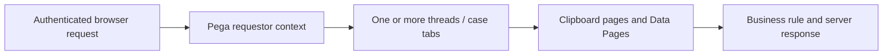

# Requestor, Thread and Clipboard Lifecycle: Diagnosing Cross-Case State Pollution

**PFA-002** | **Audience:** Pega SSA / LSA | **Lab status:** Not yet executed in a live Pega environment

## Enterprise problem

A contact-centre agent opens one customer's claim, navigates to another case and sees a stale address in an unrelated panel. The team suspects a database defect, but the same address disappears after the user signs out and returns. Requestor-level state shared across multiple case threads is the more plausible hypothesis. The architecture must define which pages belong to a case and which belong to a session, and demonstrate the actual runtime scope.

The purpose is to decide how Pega should behave when there are simultaneous users, service failures, stale state and a deployment boundary. A feature can be configured correctly at rule level but still be wrong for the business process.

## Component and runtime sequence

This is a conceptual design. It is not a claim about actual traces or a particular Pega version.

## Pega artefacts and execution context

| Rule or component | Design requirement |
|---|---|
| Operator / Access Group | Architectural responsibility and identity boundary |
| Requestor Clipboard | Rule or configuration must be version controlled |
| Thread pages and pyWorkPage | Inputs/outputs and failure model must be documented |
| Requestor-scoped Data Page | Expected observability and support ownership |
| Session and access logging | Explicit integration or release validation required |

Before implementation, record the actual Apply To class, ruleset and access group. Business responsibility must remain with the correct system of record. Context supplied through UI request parameters should be treated as untrusted until server-side authorization is applied.

## Technical implementation sequence

1. Reproduce the defect in one authenticated session while opening two unrelated cases. Capture which thread each screen interaction uses.

2. Identify Data Pages cached at Requestor scope and parameters carrying customer context. A session-wide page without all relevant identity keys may be reused incorrectly.

3. Inspect Clipboard's thread pages separately from requestor-level pages, including actual class and parameter values. Do not modify production clipboard during diagnosis.

4. Ensure child data objects are not manually stored on a global or requestor page when they should be derived from the active case.

5. Use Thread-scoped caching for case-isolated data where appropriate, and reserve Requestor scope for data truly common to the session.

6. Design session cleanup and authorization re-evaluation for user role changes; leaving a loaded page in memory does not preserve an entitlement.

7. Run concurrency tests with multiple browser tabs and session expiration, then measure cache memory under representative numbers of open cases.

### Design review questions

Who owns each state transition? Which operation is allowed to run again after a lost response? Can a cached value be shared across a session or node? How will an administrator see a failure when the original user has signed out? Each answer must be supported by a reproducible test and a named on-call owner.

## Alternatives and when to reject them

| Approach | Architectural cost and applicability |
|---|---|
| Thread-local case data | Stronger per-case isolation, may repeat common lookups |
| Requestor-level data | Reuses between case threads, requires careful parameter identity and lifecycle |
| Explicit persisted case snapshot | Audit-friendly stable content, can become stale relative to source |

Avoid adopting the fastest development path merely because it passes a single-user test. State where complexity has been moved: infrastructure scaling, cache invalidation, support recovery, version migration or customer authorization.

## Production diagnosis

A case property copied into a reusable session page may contaminate later cases. Multiple tabs can update session context in an unexpected order. A test with one case per login will not expose this fault. The key evidence is the resolved clipboard page name/class, owning thread and parameter key before and after navigation.

Build incident evidence around the case/operation identity, exact requestor or processing node, release/ruleset stack, timestamps and external correlation IDs. The same user-visible symptom can arise from rule resolution, database state, queue processing or a remote API. Investigate the layer that actually owns the failing transition.

## Controlled verification

| Test scenario | Expected behavior to observe |
|---|---|
| Lab test 1 | Open cases for two customers in separate tabs, alternating refreshes and saves. |
| Lab test 2 | Switch access group or revoke one entitlement and verify protected operations fail. |
| Lab test 3 | Compare Thread and Requestor Data Page loaded instances in Clipboard. |
| Lab test 4 | Close session and prove no stale persisted data has unintentionally been written. |

For acceptance, store actual screenshots of the rule configuration and sanitized Clipboard/Tracer/PAL data only after the experiment runs in a permitted Pega environment. Do not present theoretical timings as observed measurements.

## Production readiness checklist

- Define data classification and identity boundaries for this capability.
- Capture interface contract and dependency versions.
- Agree business freshness, latency and failure-response requirements.
- Verify retries, duplicates and parallel interactions where relevant.
- Monitor the supported recovery signal, not merely the happy-path success message.
- Retain rollback or forward-repair steps for active cases crossing a release.
- Record the target Pega version and the observed lab result before declaring the design verified.

## References

- [Pega Academy: Clipboard and Requestor fundamentals](https://academy.pega.com/topic/setting-property-values-clipboard/v1/in/2986)
- [Pega Academy: Data Page scope](https://academy.pega.com/topic/data-pages/v6)

Independent architectural analysis. Examples use fictional business details. This article is not affiliated with Pegasystems, and exact runtime options may vary by release.
