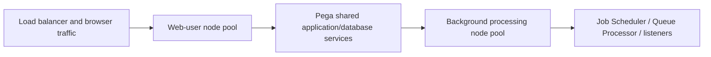

# Pega Node Classification: Separating Interactive Traffic from Background Load

**PFA-003** | **Audience:** Pega SSA / LSA | **Lab status:** Not yet executed in a live Pega environment

## Enterprise problem

A government service portal becomes slow at the top of each hour. Concurrently, a large Job Scheduler runs a report and launches background work on the same JVMs as user sessions. Adding more web nodes gives temporary relief but doesn't isolate the workload. Pega node types allow execution responsibilities such as WebUser and BackgroundProcessing to be distributed, provided the correct processing assignments exist.

The purpose is to decide how Pega should behave when there are simultaneous users, service failures, stale state and a deployment boundary. A feature can be configured correctly at rule level but still be wrong for the business process.

## Component and runtime sequence

This is a conceptual design. It is not a claim about actual traces or a particular Pega version.

## Pega artefacts and execution context

| Rule or component | Design requirement |
|---|---|
| Application server node-type JVM settings | Architectural responsibility and identity boundary |
| WebUser / BackgroundProcessing roles | Rule or configuration must be version controlled |
| Job Scheduler node association | Inputs/outputs and failure model must be documented |
| Queue Processor node association | Expected observability and support ownership |
| Node and cluster monitoring | Explicit integration or release validation required |

Before implementation, record the actual Apply To class, ruleset and access group. Business responsibility must remain with the correct system of record. Context supplied through UI request parameters should be treated as untrusted until server-side authorization is applied.

## Technical implementation sequence

1. Collect interactive p95 latency, CPU, heap, GC, DB wait and scheduled-task timing before changing topology.

2. Classify processing categories: browser requestors, Queue Processors, Job Schedulers, service endpoints, search and listeners. Record which can run on shared nodes and which needs isolation.

3. Configure node types for the target Pega release and hosting model; confirm they actually map to deployed JVM/server groups.

4. Associate recurring jobs, queues and listeners with the intended node types. A typed node without the matching task mapping might leave work unprocessed.

5. Reserve appropriate service capacity for background traffic without starving interactive nodes of shared database/stream connections.

6. Test failover capacity if one background node disappears. A separated topology that has a single worker is not resilient.

7. Compare user latency and queue backlog under synthetic overlapping peak workloads, accounting for shared DB contention that classification alone cannot remove.

### Design review questions

Who owns each state transition? Which operation is allowed to run again after a lost response? Can a cached value be shared across a session or node? How will an administrator see a failure when the original user has signed out? Each answer must be supported by a reproducible test and a named on-call owner.

## Alternatives and when to reject them

| Approach | Architectural cost and applicability |
|---|---|
| All workloads on identical nodes | Simple deployment but competition during bursts |
| Separate Web and Background node pools | Isolates CPU/heap and supports independent scaling |
| Use scheduler windows only | Useful where true off-hours exist, ineffective for global 24x7 service |

Avoid adopting the fastest development path merely because it passes a single-user test. State where complexity has been moved: infrastructure scaling, cache invalidation, support recovery, version migration or customer authorization.

## Production diagnosis

A job may run on an unintended untyped node or not run if no eligible target exists under the actual cluster topology. A dedicated background pool still competes for shared database capacity; monitor both node and shared services. A deployment that changes node role without testing Queue Processor associations can silently stop business work.

Build incident evidence around the case/operation identity, exact requestor or processing node, release/ruleset stack, timestamps and external correlation IDs. The same user-visible symptom can arise from rule resolution, database state, queue processing or a remote API. Investigate the layer that actually owns the failing transition.

## Controlled verification

| Test scenario | Expected behavior to observe |
|---|---|
| Lab test 1 | Load test user journey with a scheduled batch running on same pool. |
| Lab test 2 | Classify background work separately and compare p95 and GC. |
| Lab test 3 | Kill one worker node and observe queued work recovery. |
| Lab test 4 | Verify every scheduler/queue/listener has eligible active node types. |

For acceptance, store actual screenshots of the rule configuration and sanitized Clipboard/Tracer/PAL data only after the experiment runs in a permitted Pega environment. Do not present theoretical timings as observed measurements.

## Production readiness checklist

- Define data classification and identity boundaries for this capability.
- Capture interface contract and dependency versions.
- Agree business freshness, latency and failure-response requirements.
- Verify retries, duplicates and parallel interactions where relevant.
- Monitor the supported recovery signal, not merely the happy-path success message.
- Retain rollback or forward-repair steps for active cases crossing a release.
- Record the target Pega version and the observed lab result before declaring the design verified.

## References

- [Pega Academy: Node classification](https://academy.pega.com/topic/node-classification/v3)

Independent architectural analysis. Examples use fictional business details. This article is not affiliated with Pegasystems, and exact runtime options may vary by release.
