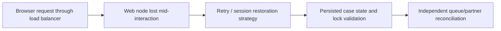

# Pega Node Loss: Designing Recovery for Sessions, Cases and Background Operations

**PFA-004** | **Audience:** Pega SSA / LSA | **Lab status:** Not yet executed in a live Pega environment

## Enterprise problem

A web node fails during a customer-service case update. The browser retries via the load balancer on another node. Meanwhile, one Queue Processor was executing a remote payment check when its worker disappeared. The product team assumes both operations automatically continue exactly once. In fact, session continuity, persisted case state, work-queue delivery and external side effects have separate recovery contracts.

The purpose is to decide how Pega should behave when there are simultaneous users, service failures, stale state and a deployment boundary. A feature can be configured correctly at rule level but still be wrong for the business process.

## Component and runtime sequence

This is a conceptual design. It is not a claim about actual traces or a particular Pega version.

## Pega artefacts and execution context

| Rule or component | Design requirement |
|---|---|
| Load balancer session policy | Architectural responsibility and identity boundary |
| Pega requestor/clipboard lifecycle | Rule or configuration must be version controlled |
| Case persistence and locking | Inputs/outputs and failure model must be documented |
| Queue Processor recovery | Expected observability and support ownership |
| External operation receipt store | Explicit integration or release validation required |

Before implementation, record the actual Apply To class, ruleset and access group. Business responsibility must remain with the correct system of record. Context supplied through UI request parameters should be treated as untrusted until server-side authorization is applied.

## Technical implementation sequence

1. Define precisely what the business promises on retry: a saved case action, restored unsaved form edits or a confirmed external business effect.

2. Test what session/requestor state is available after routing to a different node under the actual Pega deployment and authentication architecture.

3. Persist critical case changes before displaying Success. Do not treat an optimistic UI response as confirmation the server transaction committed.

4. Use business operation IDs for remote effects. After a worker loss, inspect external receipts before replaying the operation.

5. Ensure Node-scoped Data Pages can be repopulated on another node and that inconsistent node caches do not authorize a critical decision.

6. Choose lock timeout and recovery behaviour for cases abandoned mid-save. Support must distinguish stale lock from an active second editor.

7. Test failure at multiple points: before persistence, after persistence, after external commit but before acknowledgement, and during background retry.

### Design review questions

Who owns each state transition? Which operation is allowed to run again after a lost response? Can a cached value be shared across a session or node? How will an administrator see a failure when the original user has signed out? Each answer must be supported by a reproducible test and a named on-call owner.

## Alternatives and when to reject them

| Approach | Architectural cost and applicability |
|---|---|
| Retry every client request | Easy user experience but dangerous for non-idempotent saves |
| Idempotent API and durable state confirmation | Better resilience with explicit business identity |
| Force user re-entry on uncertainty | Safe fallback for high-risk actions, higher user friction |

Avoid adopting the fastest development path merely because it passes a single-user test. State where complexity has been moved: infrastructure scaling, cache invalidation, support recovery, version migration or customer authorization.

## Production diagnosis

A customer may see 'saved' when their response timed out but the server committed. Retrying with a new operation ID can double-register payment. Conversely, session loss can discard local draft content without affecting the persisted case. Logs must distinguish the original request and follow-up retry.

Build incident evidence around the case/operation identity, exact requestor or processing node, release/ruleset stack, timestamps and external correlation IDs. The same user-visible symptom can arise from rule resolution, database state, queue processing or a remote API. Investigate the layer that actually owns the failing transition.

## Controlled verification

| Test scenario | Expected behavior to observe |
|---|---|
| Lab test 1 | Kill web node before case commit and validate clean retry. |
| Lab test 2 | Kill after successful persistence before HTTP response and prevent duplicate action. |
| Lab test 3 | Kill worker after remote commit and reconcile without second payment. |
| Lab test 4 | Switch node during stale cached reference lookup and verify critical authorization. |

For acceptance, store actual screenshots of the rule configuration and sanitized Clipboard/Tracer/PAL data only after the experiment runs in a permitted Pega environment. Do not present theoretical timings as observed measurements.

## Production readiness checklist

- Define data classification and identity boundaries for this capability.
- Capture interface contract and dependency versions.
- Agree business freshness, latency and failure-response requirements.
- Verify retries, duplicates and parallel interactions where relevant.
- Monitor the supported recovery signal, not merely the happy-path success message.
- Retain rollback or forward-repair steps for active cases crossing a release.
- Record the target Pega version and the observed lab result before declaring the design verified.

## References

- [Pega Academy: Node classification](https://academy.pega.com/topic/node-classification/v3)
- [Pega Academy: Case locking](https://academy.pega.com/topic/case-locking/v7)

Independent architectural analysis. Examples use fictional business details. This article is not affiliated with Pegasystems, and exact runtime options may vary by release.
