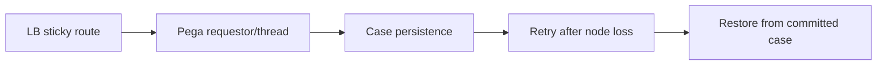

# Session affinity versus stateless application assumptions

**PFA-005** | Pega SSA/LSA engineering study | Reference architecture, not yet lab-tested

## Incident that exposes the design

A user edits a claim for twenty minutes, then a load balancer sends the next request to another node. The application assumes the requestor clipboard is available everywhere and loses unsaved UI context. This is a session-affinity failure, not a database transaction failure.

The architecture review must determine who owns the state, what survives retries, and whether the rule or infrastructure boundary actually enforces the expected behavior.

## Runtime path

## Pega-specific assets to inspect

1. **Load balancer affinity**. Establish the actual application/ruleset version, the responsible operator or runtime node, and where diagnostics for this component are captured.
2. **requestor state and Clipboard**. Establish the actual application/ruleset version, the responsible operator or runtime node, and where diagnostics for this component are captured.
3. **case lock and persistence**. Establish the actual application/ruleset version, the responsible operator or runtime node, and where diagnostics for this component are captured.
4. **authentication session**. Establish the actual application/ruleset version, the responsible operator or runtime node, and where diagnostics for this component are captured.

## Reference implementation

1. Distinguish an HTTP session, a Pega requestor and a persisted case; they have different lifetimes.

2. Test whether the chosen deployment actually restores required session state on another node. Do not infer it from healthy-node behavior.

3. Commit business state before showing success. Explicitly label unsaved local drafts as recoverable or disposable.

4. Give retries a stable action identifier so a case submission repeated after connection loss does not repeat a partner side effect.

5. Monitor reconnects, requestor recreation, stale case locks and lost-form complaints by node.

## Decision and trade-off

- **Option 1:** Sticky routing is convenient but insufficient for resilience.
- **Option 2:** stateless UI backed by committed case state is more robust but requires careful Flow Action semantics.

The selection belongs in an architecture decision record with affected system boundaries, non-functional acceptance criteria and an identified production owner.

## Failure diagnosis

Failure: session affinity hides requestor-local data dependencies until failover. A node loss after case commit but before response produces an uncertain client outcome, not proof of failed save.

For a reproducible incident, retain the affected case or operation ID, timestamp, effective ruleset stack, requestor/node, downstream correlation ID where appropriate, and the actual failing transition. Never publish live client records or authorization tokens.

## Validation experiments

1. **Test 1:** Kill web node before save. Record the precise input, expected outcome, observed server behavior and available evidence.
2. **Test 2:** kill after commit before HTTP response. Record the precise input, expected outcome, observed server behavior and available evidence.
3. **Test 3:** route to second node with two case tabs open. Record the precise input, expected outcome, observed server behavior and available evidence.

These are proposed verification experiments. No screenshot or performance result is presented as a completed run. Test on the actual installed Pega release, and record deviations from the pattern.

## Operations and production decision

Set operational alerts on the failure signal described above, not merely application health. Document how the team can retry, reconcile or repair the business transaction without duplicating remote effects. If deployment changes rules, schemas or identity policies, test active cases and queued operations crossing the release boundary.

## Documentation

- [Pega Academy: Node classification](https://academy.pega.com/topic/node-classification/v3)

*Independent technical design. Fictional scenario. Verify version-specific functionality in your own environment.*
