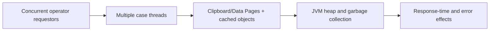

# JVM Sizing for Pega Requestor Concurrency: Memory Budgeting Beyond Heap Percentage

**PFA-006** | **Audience:** Pega SSA / LSA | **Lab status:** Not yet executed in a live Pega environment

## Enterprise problem

An organisation expects 3,000 simultaneously logged-in agents. Capacity planning uses one average page size and multiplies it by users, but the actual requestor holds multiple open case threads, parameterized Data Pages and large page lists. The JVM hits memory pressure under peak sessions, even though CPU appears acceptable. Node memory cost must be measured per requestor, case and cache instance, not inferred from a nominal concurrent-user count.

The purpose is to decide how Pega should behave when there are simultaneous users, service failures, stale state and a deployment boundary. A feature can be configured correctly at rule level but still be wrong for the business process.

## Component and runtime sequence

This is a conceptual design. It is not a claim about actual traces or a particular Pega version.

## Pega artefacts and execution context

| Rule or component | Design requirement |
|---|---|
| Requestor and Thread Clipboard | Architectural responsibility and identity boundary |
| Parameterized Data Pages | Rule or configuration must be version controlled |
| Java heap and GC monitoring | Inputs/outputs and failure model must be documented |
| PAL and PDC metrics | Expected observability and support ownership |
| Load test requestor mix | Explicit integration or release validation required |

Before implementation, record the actual Apply To class, ruleset and access group. Business responsibility must remain with the correct system of record. Context supplied through UI request parameters should be treated as untrusted until server-side authorization is applied.

## Technical implementation sequence

1. Create a representative workload model: idle authenticated users, active users, tabs per user, case sizes and parameter cardinality.

2. Warm the platform consistently and record JVM live heap after full collection in test, rather than only allocated heap and transient spikes.

3. Measure incremental retained memory as different case populations and requestor counts are introduced. Segment large and small case types.

4. Count Data Page parameter combinations across Thread and Requestor scope, including embedded lists and cached error responses.

5. Run concurrency tests that include long-lived sessions and case navigation, not only repeated independent stateless API calls.

6. Keep headroom for GC, rule assembly, integration payloads, report bursts and temporary attachment processing.

7. Set capacity thresholds based on tail latency, GC pause and allocation pressure, then test node-loss rebalancing under the surviving pool.

### Design review questions

Who owns each state transition? Which operation is allowed to run again after a lost response? Can a cached value be shared across a session or node? How will an administrator see a failure when the original user has signed out? Each answer must be supported by a reproducible test and a named on-call owner.

## Alternatives and when to reject them

| Approach | Architectural cost and applicability |
|---|---|
| Size heap from user count alone | Simple but misses session variability and per-case footprint |
| Measure requestor cohorts and parameter cardinality | Workload-specific model with defensible headroom |
| Move everything to Node cache | Can reduce duplicates but creates security/staleness risks |

Avoid adopting the fastest development path merely because it passes a single-user test. State where complexity has been moved: infrastructure scaling, cache invalidation, support recovery, version migration or customer authorization.

## Production diagnosis

A single bulky case with an embedded document list can skew memory far above the average. A short test may pass before Data Page keys accumulate. A larger heap may delay garbage collection but cannot fix unbounded cached page growth. Validate retained objects and session cleanup, not just dashboard 'heap used'.

Build incident evidence around the case/operation identity, exact requestor or processing node, release/ruleset stack, timestamps and external correlation IDs. The same user-visible symptom can arise from rule resolution, database state, queue processing or a remote API. Investigate the layer that actually owns the failing transition.

## Controlled verification

| Test scenario | Expected behavior to observe |
|---|---|
| Lab test 1 | Compare live heap after 100, 500 and 1,000 representative requestors. |
| Lab test 2 | Open multiple cases per requestor and measure incremental footprint. |
| Lab test 3 | Exercise 100 parameter combinations per session and observe memory retention. |
| Lab test 4 | Remove a worker node and check remaining pool latency and heap headroom. |

For acceptance, store actual screenshots of the rule configuration and sanitized Clipboard/Tracer/PAL data only after the experiment runs in a permitted Pega environment. Do not present theoretical timings as observed measurements.

## Production readiness checklist

- Define data classification and identity boundaries for this capability.
- Capture interface contract and dependency versions.
- Agree business freshness, latency and failure-response requirements.
- Verify retries, duplicates and parallel interactions where relevant.
- Monitor the supported recovery signal, not merely the happy-path success message.
- Retain rollback or forward-repair steps for active cases crossing a release.
- Record the target Pega version and the observed lab result before declaring the design verified.

## References

- [Pega Academy: Clipboard and Requestor fundamentals](https://academy.pega.com/topic/setting-property-values-clipboard/v1/in/2986)
- [Pega Academy: Data Pages](https://academy.pega.com/topic/data-pages/v6)

Independent architectural analysis. Examples use fictional business details. This article is not affiliated with Pegasystems, and exact runtime options may vary by release.
