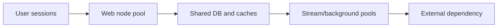

# What actually scales when additional nodes are added

**PFA-007** | Pega SSA/LSA engineering study | Reference architecture, not yet lab-tested

## Incident that exposes the design

After doubling the Pega web-node pool, p95 case response improves only slightly while database wait doubles. Adding JVMs increased concurrent requests but did not add database write throughput or partner API capacity. The scaling unit needs to match the actual bottleneck.

The architecture review must determine who owns the state, what survives retries, and whether the rule or infrastructure boundary actually enforces the expected behavior.

## Runtime path

## Pega-specific assets to inspect

1. **Node types and JVM pool**. Establish the actual application/ruleset version, the responsible operator or runtime node, and where diagnostics for this component are captured.
2. **PAL/PDC response counters**. Establish the actual application/ruleset version, the responsible operator or runtime node, and where diagnostics for this component are captured.
3. **Report Definition SQL**. Establish the actual application/ruleset version, the responsible operator or runtime node, and where diagnostics for this component are captured.
4. **Queue Processor throughput**. Establish the actual application/ruleset version, the responsible operator or runtime node, and where diagnostics for this component are captured.

## Reference implementation

1. Define the workload as interactive cases per second, active requestors, queues processed and background jobs, not a generic CPU percentage.

2. Measure CPU, GC, Pega rule time, database wait and external connector elapsed on the same business journey.

3. For a database-bound action, tune query/transaction contention before scaling web nodes; extra concurrency may worsen throughput.

4. For queue-driven work, test independent background capacity and downstream rate limits rather than counting web JVMs.

5. Use a capacity curve at increasing node counts; identify where throughput plateaus and which shared resource saturates.

## Decision and trade-off

- **Option 1:** More nodes help CPU-bound rule work.
- **Option 2:** more nodes cannot eliminate shared database hotspots or vendor quotas.

The selection belongs in an architecture decision record with affected system boundaries, non-functional acceptance criteria and an identified production owner.

## Failure diagnosis

Failure: nodes appear underutilized because sessions wait on a common slow dependency. A faster user pool can overload the Queue Processor producer path.

For a reproducible incident, retain the affected case or operation ID, timestamp, effective ruleset stack, requestor/node, downstream correlation ID where appropriate, and the actual failing transition. Never publish live client records or authorization tokens.

## Validation experiments

1. **Test 1:** Load-test 2,4,8 web nodes at equal case mix. Record the precise input, expected outcome, observed server behavior and available evidence.
2. **Test 2:** inspect DB p95 and lock waits. Record the precise input, expected outcome, observed server behavior and available evidence.
3. **Test 3:** repeat with partner 429 responses. Record the precise input, expected outcome, observed server behavior and available evidence.

These are proposed verification experiments. No screenshot or performance result is presented as a completed run. Test on the actual installed Pega release, and record deviations from the pattern.

## Operations and production decision

Set operational alerts on the failure signal described above, not merely application health. Document how the team can retry, reconcile or repair the business transaction without duplicating remote effects. If deployment changes rules, schemas or identity policies, test active cases and queued operations crossing the release boundary.

## Documentation

- [Pega Academy: Node classification](https://academy.pega.com/topic/node-classification/v3)

*Independent technical design. Fictional scenario. Verify version-specific functionality in your own environment.*
