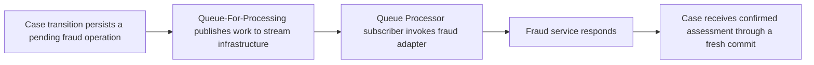

# Stream Service Failure: When Cases Save but Background Work Stops

**PFA-008** | **Audience:** Senior and Lead System Architects | **Status:** Architecture design, live Pega verification pending

## The actual failure

An insurer's claims portal remains available while fraud checks remain in Pending after a stream infrastructure change. Engineers see successful case saves and conclude the platform is fine. It is not. The interactive transaction and the queue consumer depend on different runtime paths. Queue Processor work uses a stream-backed data flow, so the business must distinguish an accepted case from a completed fraud outcome.

## System interaction and ownership

This is a conceptual reference architecture, not a product screenshot or observed runtime trace. Its boundaries must be verified for the actual Pega deployment version and external systems.

## Pega implementation inventory

| Component or rule | Design consideration |
|---|---|
| Case FraudAssessmentPending state | Owns a defined runtime decision or state boundary |
| Queue Processor rule for fraud requests | Needs a documented input/output contract |
| Stream service and data flow | Requires version-specific access and execution testing |
| Fraud Connect REST adapter | Produces diagnostics for failure isolation |
| Reconciliation scheduler and receipt ledger | Carries operational ownership |

## How to implement and validate the architecture

1. Persist an immutable fraud operation ID, expected result deadline and Pending status before dispatch. Avoid storing success until a receipt exists.

2. Inspect the Pega Stream landing page, QueueProcessors landing page and data flow state. In external Kafka deployments collect broker and consumer information from the infrastructure team.

3. Separate backlog count from backlog age. Model drain time as outstanding eligible operations divided by sustainable net completion throughput, allowing for retries and partner quota.

4. Use a durable reconciliation query: Pending operation IDs without confirmed partner receipts are candidates for investigation or controlled replay.

5. Define a business policy for stream unavailability. Notifications may lag but settlement must not proceed without confirmed fraud acceptance.

6. Document start-up ordering, node roles and capacity so recovery after maintenance does not silently leave consumers disabled.

For a production build, annotate the actual class names, access group, ruleset version, node role and recovery owner. Ensure each external operation has an explicit system of record; a successful Pega case save does not, by itself, certify that an external service committed a change.

## Architectural choices

| Pattern | Consequence |
|---|---|
| Only case-save success checked | Fast but incorrectly classifies unprocessed fraud work as complete |
| Queue status plus receipt reconciliation | Distinguishes transport, worker and final business outcome |
| Synchronous fraud check in user request | Simpler proof of outcome but makes portal dependent on latency and availability |

Choose by the actual confidentiality, scale, consistency and failure-recovery constraints. A seemingly quicker configuration can shift cost into production support, data repair or lost auditability.

## Failure mechanics and support diagnosis

Healthy cases with growing queue lag indicate a background path fault. A connected broker with inactive subscriber means connectivity alone is insufficient. Poison messages can mask a secondary error. A partner outage can also cause retries that outlive the original stream incident. Diagnose one operation ID end to end.

Correlate one affected case ID and operation ID across rule execution, logs and dependent services. Record the effective application/ruleset versions and node. Avoid exporting live client data or confidential prompts in community evidence.

## Test matrix

| Test | Expected verification |
|---|---|
| Experiment 1 | Disable stream consumption after enqueue, restore it and verify eventual processing. |
| Experiment 2 | Restart the background consumer after remote success but before local acknowledgment; no duplicate business effect. |
| Experiment 3 | Produce a controlled backlog and record drain rate plus worst-case age. |
| Experiment 4 | Break stream connectivity and confirm the case UI labels the operation Pending, not Approved. |

These are **experiments to execute**, not assertions of a completed test. Include Pega configuration screenshots and sanitized Clipboard, Tracer, PAL or service evidence only after an authorised lab run. A failing experiment is valuable evidence and should update the design.

## Release and production readiness

Before promoting the design, confirm: observable business state; retry and rollback constraints; tenant and privilege isolation; capacity target; accountable support team; release-specific configuration; and a documented repair procedure. A green rule test or a running node does not imply the complete business operation succeeded.

## Primary reference

- [Pega Academy technical documentation](https://academy.pega.com/topic/stream-service/v3)

This article is an independent architectural study. The example scenario is fictional. It is not affiliated with Pegasystems, and no performance measurement or live test result is claimed.
