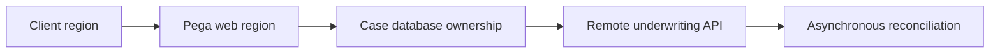

# Multi-region deployment and latency-sensitive workflows

**PFA-009** | Pega SSA/LSA engineering study | Reference architecture, not yet lab-tested

## Incident that exposes the design

An insurer deploys a customer-facing Pega application in two geographic regions. Cases initiated in Europe need a US underwriting API; every synchronous validation crosses a high-latency link, and failover may route traffic to a region with an outdated dependency configuration. Multi-region placement is a business consistency and dependency problem.

The architecture review must determine who owns the state, what survives retries, and whether the rule or infrastructure boundary actually enforces the expected behavior.

## Runtime path

## Pega-specific assets to inspect

1. **Pega Cloud/hosting topology**. Establish the actual application/ruleset version, the responsible operator or runtime node, and where diagnostics for this component are captured.
2. **Connect REST endpoints**. Establish the actual application/ruleset version, the responsible operator or runtime node, and where diagnostics for this component are captured.
3. **case-lock ownership**. Establish the actual application/ruleset version, the responsible operator or runtime node, and where diagnostics for this component are captured.
4. **Data Page caching**. Establish the actual application/ruleset version, the responsible operator or runtime node, and where diagnostics for this component are captured.

## Reference implementation

1. Draw latency and legal data-residency boundaries around each case, document and identity source before selecting regions.

2. Separate latency-sensitive case display from irreversible underwriting and payment decisions: cached summaries may be acceptable for display but not approval.

3. Model the authoritative persistence location and writes during a regional outage. Do not promise active-active case writes without a proven consistency design.

4. Use bounded API timeout and outcome reconciliation for remote calls, with correlation IDs across regional hops.

5. Rehearse region failover under a realistic mix of open assignments, active requestors and queued side effects.

## Decision and trade-off

- **Option 1:** Single active write region simplifies consistency.
- **Option 2:** multiple independent write regions require conflict and ownership rules.

The selection belongs in an architecture decision record with affected system boundaries, non-functional acceptance criteria and an identified production owner.

## Failure diagnosis

Failure: DNS or route failover succeeds but external API secrets, allowlists or callback URLs differ, leaving workflows partially active.

For a reproducible incident, retain the affected case or operation ID, timestamp, effective ruleset stack, requestor/node, downstream correlation ID where appropriate, and the actual failing transition. Never publish live client records or authorization tokens.

## Validation experiments

1. **Test 1:** Simulate inter-region 250ms latency. Record the precise input, expected outcome, observed server behavior and available evidence.
2. **Test 2:** disable one region during in-flight API call. Record the precise input, expected outcome, observed server behavior and available evidence.
3. **Test 3:** test callback returning to old region. Record the precise input, expected outcome, observed server behavior and available evidence.

These are proposed verification experiments. No screenshot or performance result is presented as a completed run. Test on the actual installed Pega release, and record deviations from the pattern.

## Operations and production decision

Set operational alerts on the failure signal described above, not merely application health. Document how the team can retry, reconcile or repair the business transaction without duplicating remote effects. If deployment changes rules, schemas or identity policies, test active cases and queued operations crossing the release boundary.

## Documentation

- [Pega Academy: Node classification](https://academy.pega.com/topic/node-classification/v3)

*Independent technical design. Fictional scenario. Verify version-specific functionality in your own environment.*
