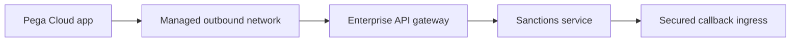

# Pega Cloud connectivity boundaries for enterprise APIs

**PFA-010** | Pega SSA/LSA engineering study | Reference architecture, not yet lab-tested

## Incident that exposes the design

A Pega Cloud application must call an enterprise Azure-hosted sanctions service and receive signed callbacks. Engineers create a Connect REST rule and expect network access without an infrastructure contract. The connector exists, but routing, firewall allowlists, TLS trust and inbound endpoint policy are outside rule configuration.

The architecture review must determine who owns the state, what survives retries, and whether the rule or infrastructure boundary actually enforces the expected behavior.

## Runtime path

## Pega-specific assets to inspect

1. **Connect REST**. Establish the actual application/ruleset version, the responsible operator or runtime node, and where diagnostics for this component are captured.
2. **Authentication Profile**. Establish the actual application/ruleset version, the responsible operator or runtime node, and where diagnostics for this component are captured.
3. **Service REST and Service Package**. Establish the actual application/ruleset version, the responsible operator or runtime node, and where diagnostics for this component are captured.
4. **TLS trust and endpoints**. Establish the actual application/ruleset version, the responsible operator or runtime node, and where diagnostics for this component are captured.

## Reference implementation

1. Produce a data-flow map with every source, destination, port, trust boundary and owner. Record whether calls are inbound to Pega or outbound from Pega.

2. Validate DNS, outbound routing, approved gateway and TLS identity before designing Pega error mapping; a successful rule test in another network is insufficient.

3. Use an Authentication Profile and managed secret rotation instead of embedding credentials in rule properties.

4. Protect callbacks through an approved ingress/gateway with authenticated Service REST, stable operation ID and replay controls.

5. Record vendor processing location and data classification so Cloud connectivity does not silently export restricted case fields.

## Decision and trade-off

- **Option 1:** Private approved connectivity may meet sensitive-data policy.
- **Option 2:** public endpoint through gateway may be simpler but requires strong external controls.

The selection belongs in an architecture decision record with affected system boundaries, non-functional acceptance criteria and an identified production owner.

## Failure diagnosis

Failure: an outbound route is permitted in test but not production; a source IP changes and the vendor blocks calls; callback ingress succeeds without adequate authorization.

For a reproducible incident, retain the affected case or operation ID, timestamp, effective ruleset stack, requestor/node, downstream correlation ID where appropriate, and the actual failing transition. Never publish live client records or authorization tokens.

## Validation experiments

1. **Test 1:** Perform TLS handshake and authentication test in each environment. Record the precise input, expected outcome, observed server behavior and available evidence.
2. **Test 2:** rotate secret. Record the precise input, expected outcome, observed server behavior and available evidence.
3. **Test 3:** replay signed callback after timeout. Record the precise input, expected outcome, observed server behavior and available evidence.

These are proposed verification experiments. No screenshot or performance result is presented as a completed run. Test on the actual installed Pega release, and record deviations from the pattern.

## Operations and production decision

Set operational alerts on the failure signal described above, not merely application health. Document how the team can retry, reconcile or repair the business transaction without duplicating remote effects. If deployment changes rules, schemas or identity policies, test active cases and queued operations crossing the release boundary.

## Documentation

- [Pega Academy: Authentication](https://academy.pega.com/topic/authentication/v6)

*Independent technical design. Fictional scenario. Verify version-specific functionality in your own environment.*
