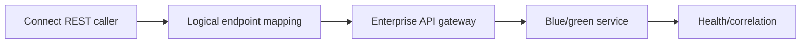

# Managing internal service discovery and endpoint changes

**PFA-011** | Pega SSA/LSA engineering study | Reference architecture, not yet lab-tested

## Incident that exposes the design

A microservice moves to a new internal DNS name. Pega's integration rule hard-codes a hostname in several rulesets, forcing code releases for an infrastructure change. Other nodes still resolve a stale address due to cache or configuration differences.

The architecture review must determine who owns the state, what survives retries, and whether the rule or infrastructure boundary actually enforces the expected behavior.

## Runtime path

## Pega-specific assets to inspect

1. **Connect REST endpoint**. Establish the actual application/ruleset version, the responsible operator or runtime node, and where diagnostics for this component are captured.
2. **Dynamic System Settings or environment config**. Establish the actual application/ruleset version, the responsible operator or runtime node, and where diagnostics for this component are captured.
3. **Authentication Profile**. Establish the actual application/ruleset version, the responsible operator or runtime node, and where diagnostics for this component are captured.
4. **API gateway**. Establish the actual application/ruleset version, the responsible operator or runtime node, and where diagnostics for this component are captured.

## Reference implementation

1. Create a logical destination identity separate from the physical address, and assign an explicit configuration owner.

2. Use environment-specific endpoint configuration rather than copying rules for dev, test and production.

3. Keep authentication profile and TLS server identity aligned when DNS or gateway route changes; an address change can change the required host certificate.

4. Define cutover semantics for in-flight calls: old requests may succeed after the new route is active, so writes need idempotency.

5. Validate configuration on all application nodes and capture connector destination, DNS and response behavior in a controlled trace.

## Decision and trade-off

- **Option 1:** Direct endpoint simplifies one environment but creates release coupling.
- **Option 2:** gateway route abstracts service churn with gateway ownership cost.

The selection belongs in an architecture decision record with affected system boundaries, non-functional acceptance criteria and an identified production owner.

## Failure diagnosis

Failure: stale endpoint values survive on only some nodes, producing intermittent 404/timeout by node rather than by customer.

For a reproducible incident, retain the affected case or operation ID, timestamp, effective ruleset stack, requestor/node, downstream correlation ID where appropriate, and the actual failing transition. Never publish live client records or authorization tokens.

## Validation experiments

1. **Test 1:** Switch backend with staged traffic. Record the precise input, expected outcome, observed server behavior and available evidence.
2. **Test 2:** revert route during pending request. Record the precise input, expected outcome, observed server behavior and available evidence.
3. **Test 3:** rotate TLS certificate and inspect handshake. Record the precise input, expected outcome, observed server behavior and available evidence.

These are proposed verification experiments. No screenshot or performance result is presented as a completed run. Test on the actual installed Pega release, and record deviations from the pattern.

## Operations and production decision

Set operational alerts on the failure signal described above, not merely application health. Document how the team can retry, reconcile or repair the business transaction without duplicating remote effects. If deployment changes rules, schemas or identity policies, test active cases and queued operations crossing the release boundary.

## Documentation

- [Pega Academy: Authentication](https://academy.pega.com/topic/authentication/v6)

*Independent technical design. Fictional scenario. Verify version-specific functionality in your own environment.*
