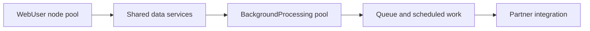

# Separating interaction and background service capacity

**PFA-012** | Pega SSA/LSA engineering study | Reference architecture, not yet lab-tested

## Incident that exposes the design

At midnight a legacy bulk process starts and the contact centre's claim forms become slow. Background work and interactive sessions share CPU, heap and database connections. Treating both as one compute pool couples service levels even when the business tasks are unrelated.

The architecture review must determine who owns the state, what survives retries, and whether the rule or infrastructure boundary actually enforces the expected behavior.

## Runtime path

## Pega-specific assets to inspect

1. **Node classification JVM arguments**. Establish the actual application/ruleset version, the responsible operator or runtime node, and where diagnostics for this component are captured.
2. **Job Scheduler**. Establish the actual application/ruleset version, the responsible operator or runtime node, and where diagnostics for this component are captured.
3. **Queue Processor**. Establish the actual application/ruleset version, the responsible operator or runtime node, and where diagnostics for this component are captured.
4. **database connection pools**. Establish the actual application/ruleset version, the responsible operator or runtime node, and where diagnostics for this component are captured.

## Reference implementation

1. Inventory transaction classes and write a separate throughput/latency objective for interactive actions versus jobs.

2. Classify Pega nodes for intended workloads, and verify the Job Scheduler and Queue Processor associations actually resolve to eligible nodes.

3. Limit worker concurrency based on total DB and vendor dependency capacity, not just background-node CPU.

4. Create priority rules for critical settlement messages rather than sending them through the same high-volume email workload.

5. Test simultaneous production-like batch and browser traffic, measuring p95 case response and oldest queued item age.

## Decision and trade-off

- **Option 1:** Workload-isolated nodes reduce CPU contention.
- **Option 2:** the DB remains shared, so isolation without query tuning may not help.

The selection belongs in an architecture decision record with affected system boundaries, non-functional acceptance criteria and an identified production owner.

## Failure diagnosis

Failure: moving a job frees CPU but it still locks the same hot work table; a background-only pool has no active workers after an outage.

For a reproducible incident, retain the affected case or operation ID, timestamp, effective ruleset stack, requestor/node, downstream correlation ID where appropriate, and the actual failing transition. Never publish live client records or authorization tokens.

## Validation experiments

1. **Test 1:** Run peak UI load with scheduler enabled. Record the precise input, expected outcome, observed server behavior and available evidence.
2. **Test 2:** compare before/after node classes. Record the precise input, expected outcome, observed server behavior and available evidence.
3. **Test 3:** kill one background node. Record the precise input, expected outcome, observed server behavior and available evidence.

These are proposed verification experiments. No screenshot or performance result is presented as a completed run. Test on the actual installed Pega release, and record deviations from the pattern.

## Operations and production decision

Set operational alerts on the failure signal described above, not merely application health. Document how the team can retry, reconcile or repair the business transaction without duplicating remote effects. If deployment changes rules, schemas or identity policies, test active cases and queued operations crossing the release boundary.

## Documentation

- [Pega Academy: Node classification](https://academy.pega.com/topic/node-classification/v3)

*Independent technical design. Fictional scenario. Verify version-specific functionality in your own environment.*
