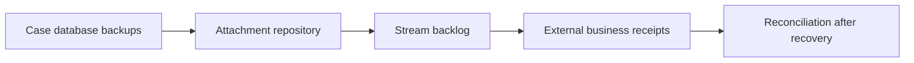

# Disaster recovery objectives for case processing

**PFA-013** | Pega SSA/LSA engineering study | Reference architecture, not yet lab-tested

## Incident that exposes the design

A disaster-recovery plan promises a four-hour recovery for an application, but does not state whether newly issued policies, documents and queued registration messages are also recoverable. Restoring Pega web nodes is not the same as recovering the last committed business state.

The architecture review must determine who owns the state, what survives retries, and whether the rule or infrastructure boundary actually enforces the expected behavior.

## Runtime path

## Pega-specific assets to inspect

1. **Case tables and history**. Establish the actual application/ruleset version, the responsible operator or runtime node, and where diagnostics for this component are captured.
2. **attachment storage**. Establish the actual application/ruleset version, the responsible operator or runtime node, and where diagnostics for this component are captured.
3. **Queue Processor**. Establish the actual application/ruleset version, the responsible operator or runtime node, and where diagnostics for this component are captured.
4. **recovery ledger**. Establish the actual application/ruleset version, the responsible operator or runtime node, and where diagnostics for this component are captured.

## Reference implementation

1. Define RPO and RTO independently for cases, attachments, rule artifacts and asynchronous work; a single generic target is misleading.

2. Identify authoritative state by operation: which system owns issued policies, external payments and case workflow decisions.

3. Build a restore order for database, configuration/secrets, attachment references, stream processors and callback endpoints.

4. Use durable operation IDs to reconcile remote effects after restore, avoiding duplicate payment or policy issuance when backups lag remote transactions.

5. Test an actual restore of a chosen point in time and measure missing/duplicate operations, unresolved callbacks and case locks.

## Decision and trade-off

- **Option 1:** Backup restore alone is easy to describe but misses cross-system consistency.
- **Option 2:** recovery with reconciliation is more complex and auditable.

The selection belongs in an architecture decision record with affected system boundaries, non-functional acceptance criteria and an identified production owner.

## Failure diagnosis

Failure: cases roll back to Pending but the partner has already issued policies. Automatic replay with fresh IDs creates a second issuance.

For a reproducible incident, retain the affected case or operation ID, timestamp, effective ruleset stack, requestor/node, downstream correlation ID where appropriate, and the actual failing transition. Never publish live client records or authorization tokens.

## Validation experiments

1. **Test 1:** Restore snapshot while a message is in flight. Record the precise input, expected outcome, observed server behavior and available evidence.
2. **Test 2:** replay callback after restoration. Record the precise input, expected outcome, observed server behavior and available evidence.
3. **Test 3:** verify attachments for restored case versions. Record the precise input, expected outcome, observed server behavior and available evidence.

These are proposed verification experiments. No screenshot or performance result is presented as a completed run. Test on the actual installed Pega release, and record deviations from the pattern.

## Operations and production decision

Set operational alerts on the failure signal described above, not merely application health. Document how the team can retry, reconcile or repair the business transaction without duplicating remote effects. If deployment changes rules, schemas or identity policies, test active cases and queued operations crossing the release boundary.

## Documentation

- [Pega Academy: Queue processors](https://academy.pega.com/topic/queue-processors-and-job-schedulers/v2)

*Independent technical design. Fictional scenario. Verify version-specific functionality in your own environment.*
