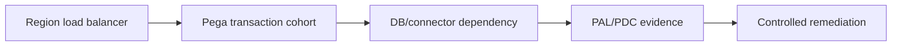

# Identifying bottlenecks during a new regional rollout

**PFA-014** | Pega SSA/LSA engineering study | Reference architecture, not yet lab-tested

## Incident that exposes the design

A regional launch doubles workload and several screens become slow, but only some users are affected. Adding nodes on the assumption of global scale may mask a region-specific connector route, unoptimized worklist or expensive case type.

The architecture review must determine who owns the state, what survives retries, and whether the rule or infrastructure boundary actually enforces the expected behavior.

## Runtime path

## Pega-specific assets to inspect

1. **PAL**. Establish the actual application/ruleset version, the responsible operator or runtime node, and where diagnostics for this component are captured.
2. **PDC**. Establish the actual application/ruleset version, the responsible operator or runtime node, and where diagnostics for this component are captured.
3. **DBTrace**. Establish the actual application/ruleset version, the responsible operator or runtime node, and where diagnostics for this component are captured.
4. **Connect REST**. Establish the actual application/ruleset version, the responsible operator or runtime node, and where diagnostics for this component are captured.
5. **load-test script**. Establish the actual application/ruleset version, the responsible operator or runtime node, and where diagnostics for this component are captured.

## Reference implementation

1. Break monitoring down by region, case type, stage, operator cohort and deployment version before tuning.

2. Capture real transaction path and cold-versus-warm behavior for the slow cohort. Averages across all cases hide hot paths.

3. Compare Pega rule elapsed, SQL wait, remote API time and requestor clipboard size; find what differs by region.

4. Reproduce using regional endpoint settings and realistic dataset volume, not the smallest synthetic case.

5. Choose a measurable change and rerun matched workloads; confirm that improvement did not sacrifice data freshness or tenant isolation.

## Decision and trade-off

- **Option 1:** Increase capacity for CPU saturation.
- **Option 2:** tune queries for DB wait.
- **Option 3:** optimize routing for regional API latency.

The selection belongs in an architecture decision record with affected system boundaries, non-functional acceptance criteria and an identified production owner.

## Failure diagnosis

Failure: a load balancer route selects the wrong regional gateway, giving intermittent slow responses; PAL on a different cohort shows misleading numbers.

For a reproducible incident, retain the affected case or operation ID, timestamp, effective ruleset stack, requestor/node, downstream correlation ID where appropriate, and the actual failing transition. Never publish live client records or authorization tokens.

## Validation experiments

1. **Test 1:** Replay slow and fast cohorts with same input. Record the precise input, expected outcome, observed server behavior and available evidence.
2. **Test 2:** simulate regional API delay. Record the precise input, expected outcome, observed server behavior and available evidence.
3. **Test 3:** compare identical report plans. Record the precise input, expected outcome, observed server behavior and available evidence.

These are proposed verification experiments. No screenshot or performance result is presented as a completed run. Test on the actual installed Pega release, and record deviations from the pattern.

## Operations and production decision

Set operational alerts on the failure signal described above, not merely application health. Document how the team can retry, reconcile or repair the business transaction without duplicating remote effects. If deployment changes rules, schemas or identity policies, test active cases and queued operations crossing the release boundary.

## Documentation

- [Pega Academy: Node classification](https://academy.pega.com/topic/node-classification/v3)

*Independent technical design. Fictional scenario. Verify version-specific functionality in your own environment.*
