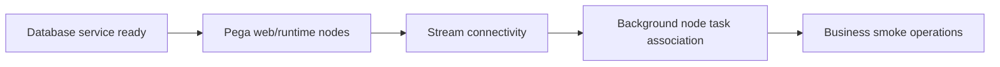

# Startup sequencing after infrastructure maintenance

**PFA-015** | Pega SSA/LSA engineering study | Reference architecture, not yet lab-tested

## Incident that exposes the design

After planned maintenance, Pega web nodes respond to health checks but background settlement jobs do not resume. Infrastructure scripts treat all service readiness as one Boolean, while background processing depends on stream connectivity, eligible node roles and valid runtime configuration.

The architecture review must determine who owns the state, what survives retries, and whether the rule or infrastructure boundary actually enforces the expected behavior.

## Runtime path

## Pega-specific assets to inspect

1. **Node classification**. Establish the actual application/ruleset version, the responsible operator or runtime node, and where diagnostics for this component are captured.
2. **Stream service**. Establish the actual application/ruleset version, the responsible operator or runtime node, and where diagnostics for this component are captured.
3. **Queue Processor**. Establish the actual application/ruleset version, the responsible operator or runtime node, and where diagnostics for this component are captured.
4. **Job Scheduler**. Establish the actual application/ruleset version, the responsible operator or runtime node, and where diagnostics for this component are captured.

## Reference implementation

1. Document explicit dependencies among DB, authentication, secrets, stream infrastructure and application node startup.

2. Start a minimal pool first and confirm real case read/write, not just an HTTP 200 from the server.

3. Verify each Queue Processor and Job Scheduler has at least one eligible running node with proper access context.

4. Warm only safe shared reference Data Pages where justified. Do not cause a stampede of external API calls during startup.

5. Run a business smoke case that queues a noncritical operation and observes a confirmed receipt before declaring recovery complete.

## Decision and trade-off

- **Option 1:** All-at-once restart is faster on paper.
- **Option 2:** ordered readiness with checks prevents silent service gaps.

The selection belongs in an architecture decision record with affected system boundaries, non-functional acceptance criteria and an identified production owner.

## Failure diagnosis

Failure: an apparently healthy cluster cannot drain queue backlog because its workers are connected to the wrong stream endpoint or no background node is eligible.

For a reproducible incident, retain the affected case or operation ID, timestamp, effective ruleset stack, requestor/node, downstream correlation ID where appropriate, and the actual failing transition. Never publish live client records or authorization tokens.

## Validation experiments

1. **Test 1:** Restart background nodes last. Record the precise input, expected outcome, observed server behavior and available evidence.
2. **Test 2:** simulate stream-not-ready. Record the precise input, expected outcome, observed server behavior and available evidence.
3. **Test 3:** revoke worker access group temporarily. Record the precise input, expected outcome, observed server behavior and available evidence.

These are proposed verification experiments. No screenshot or performance result is presented as a completed run. Test on the actual installed Pega release, and record deviations from the pattern.

## Operations and production decision

Set operational alerts on the failure signal described above, not merely application health. Document how the team can retry, reconcile or repair the business transaction without duplicating remote effects. If deployment changes rules, schemas or identity policies, test active cases and queued operations crossing the release boundary.

## Documentation

- [Pega Academy: Node classification](https://academy.pega.com/topic/node-classification/v3)

*Independent technical design. Fictional scenario. Verify version-specific functionality in your own environment.*
