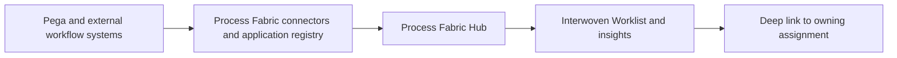

# Process Fabric Hub: A Federated Worklist Without Moving Every Case to One Platform

**PFA-241** | Technical design study for Pega Senior and Lead System Architects | Laboratory verification pending

## Architecture problem

An enterprise has claims managed in Pega, HR tasks in another workflow system and finance approvals in a third. Staff log into three portals and managers cannot compare assignment urgency. A proposal to centralize all case data inside one new application creates a migration programme. Process Fabric Hub can aggregate assignments across registered systems while their business records remain in the originating applications.

## System design

This diagram records a proposed boundary, not a fabricated Pega runtime screenshot. The interfaces and exact rule forms must be verified in a permitted sandbox.

## Feature inventory and design responsibilities

| Pega rule or component | Review requirement |
|---|---|
| Process Fabric Hub application registry | Primary configuration and ownership boundary |
| App-to-app connectors | Explicit input/output and identity contract |
| Interwoven Worklist | Apply platform-version-specific controls |
| Operator and work queue mapping | Test failure handling and observability |
| Assignment synchronization and links | Validate runtime access and support procedure |

## Implementation approach

1. Define system of record for every assignment. Process Fabric aggregation should not imply transfer of case ownership or approval authority.

2. Register each participating application and specify assignment identity, status, priority, due time and target link semantics.

3. Map operator identities and work queues across systems; one employee may have different credentials or entitlements per source.

4. Design synchronization, delayed updates, assignment cancellation and retry rules explicitly.

5. Avoid copying protected case details where a summary, deep link or scoped action is sufficient.

6. Define cross-system urgency comparability so prioritization does not falsely equate different SLA definitions.

7. Audit assignment completion in the owning system and reconcile stale hub entries against source status.

## Design alternatives

| Option | Architectural trade-off |
|---|---|
| Rebuild every workflow in one Pega application | Large migration risk and duplicated business logic |
| Federated Process Fabric Hub | Cross-system visibility with source ownership retained |
| Simple hyperlink directory | Cheap but no unified assignments or prioritized work |

Choose the option that satisfies the business consistency contract and operational constraints. Avoid proving only the success path while deferring security, stale state and recovery behaviour.

## Failure modes and troubleshooting

A completed remote assignment may linger in the hub during synchronization delay. Two applications may use colliding assignment IDs. SSO may authenticate to the hub without authorizing a source assignment. Treat the owning application as authoritative for work completion.

Capture a sanitized case ID or operation identifier, relevant runtime node, application/ruleset version and timestamps. Correlate the origin and outcome across Pega and partner systems instead of relying on a single status message.

## Verification experiments

| Scenario | Evidence required |
|---|---|
| Experiment 1 | Register two source apps and verify distinct assignment identities. |
| Experiment 2 | Complete remote assignment and measure hub reconciliation delay. |
| Experiment 3 | Revoke source permission while work remains visible in hub; opening must be denied. |
| Experiment 4 | Take one source offline and confirm graceful partial worklist behavior. |

These are experiments to perform in a Pega lab. The article does not claim that any test has passed. A lab-verified version should include actual configuration screenshots, observed results and target Pega version.

## Production acceptance

Before deployment, the implementation needs documented data ownership, access context, expected peak volume, case compatibility, timeouts and retry boundaries, monitoring, escalation owner and a tested operational repair path. If the design changes a data model or class structure, verify legacy case paths and queued work.

## Pega technical source

- [Primary Pega reference](https://academy.pega.com/topic/pega-case-fabric-hub-basics/v1/in/91986/92016)

Independent original technical analysis. Pega version-specific features and terminology must be confirmed against the target release; the scenario is fictional.
