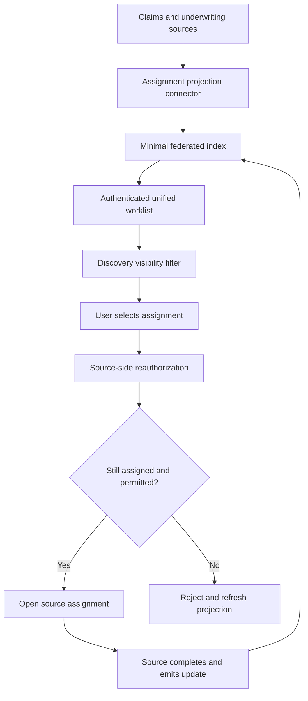

# Cross-application work discovery and permissions

## Failure scenario: a unified worklist exposes the wrong customer's task

A global insurer connects claims, underwriting and complaints systems to a federated work surface. An underwriter can see a claims task in the unified list because its metadata was indexed for discovery, even though the source claims system would not permit that operator to open it. The team assumed that access to a Process Fabric worklist implied authorization in every source application. A stale assignment also remains visible after its owner changes.

The architectural rule is **discovery is not execution authorization**. A federated worklist may show a minimal, permitted projection of work; the source system remains authoritative for task ownership, case access and completion. Never turn a cached assignment index into a universal permission grant.

## System boundaries and Pega objects

Use Pega Process Fabric Hub or the supported equivalent for the installed product version to aggregate work references. Model each external assignment with a stable source system ID, source assignment ID, case reference, source version or update timestamp, allowed work category, current assignee and minimal display metadata. Do not copy confidential case attachments or full `pyWorkPage` payloads into the federation index.

In source Pega applications, enforce Access Groups, Access Roles to Objects, Privileges and ABAC Access Control Policies where applicable. For non-Pega sources, define equivalent service-side authorization and a scoped API contract. A portal deep link is a navigation mechanism, not a security boundary. Source authentication and session establishment must be evaluated when the user opens or completes work.

## Federated access flow

## Architecture and implementation steps

1. **Document source ownership.** For every connected application, name the source of truth for assignment state, case data, operator identity and permissions. Define whether the hub receives events, polls or invokes a query API.
2. **Specify the projection schema.** Include `sourceSystem`, `sourceAssignmentId`, `sourceCaseId`, `sourceVersion`, `lastUpdatedUtc`, category, due date and a non-sensitive display label. Use an opaque key for cross-system uniqueness. A shared `pyID` format alone is not globally unique.
3. **Design identity federation.** Map the user's enterprise identity to source-system identity using a reviewed identity-provider contract. Do not infer access from a matching email address or display name. Define what happens when a user is deactivated or transferred.
4. **Apply minimal discovery visibility.** Expose only fields approved for worklist display. If the hub cannot evaluate a source's permission model accurately, reduce the projection and require source authorization before revealing details.
5. **Reauthorize on click and completion.** Resolve the assignment against the source's current state. Verify ownership, source access group, object-level permissions and assignment version. Return a neutral unavailable message when access is denied.
6. **Handle eventual consistency.** Treat hub entries as hints. When an assignment is reassigned or completed, source events or polling update the index. Use monotonically ordered versions where possible so a delayed event cannot resurrect an old assignment.
7. **Define failure and retry semantics.** A source outage may leave stale entries visible. Mark them as temporarily unavailable rather than claiming completion. Retrying a completion request requires a source-specific idempotency key and status reconciliation.
8. **Design operational controls.** Monitor source connector lag, orphaned assignment references, authorization denials, duplicate keys, failed deep links and source response time. Give support staff a trace path from hub entry to source event without exposing confidential payloads.
9. **Plan revocation.** Test removal of a user's source role while their hub session remains active. Force a fresh source authorization decision and ensure sensitive task details are not cached in the browser.

## Tradeoffs and production mechanics

A central work index improves discovery latency but introduces staleness and a second copy of metadata. Live querying each source gives fresher authorization decisions but increases dependency on every source's availability. A hybrid design can index safe summaries and revalidate on action. Deep linking preserves source UI behavior but fragments the user experience; embedded task completion offers a smoother interface but increases the hub's authorization and API obligations.

An assignment may be completed in the source while still present in the hub, or a source may emit events out of order. These are normal distributed-system conditions. A robust design treats the source response as authoritative and removes or refreshes the stale projection rather than trying to repair source work from the hub.

## Reproducible verification matrix

| Scenario | Test action | Required result |
| --- | --- | --- |
| Authorized work | User opens own source assignment | Source grants current permission |
| Cross-tenant task | Inject visible foreign assignment | No sensitive details or completion |
| Access revoked | Remove role after hub login | Source denies subsequent open |
| Reassignment | Change owner while task is listed | Old user cannot complete |
| Out-of-order event | Deliver older projection after newer one | Older state does not overwrite newer |
| Source unavailable | Disconnect source API | Hub shows safe unavailable state |
| Duplicate source IDs | Same local ID in two systems | Composite key prevents collision |
| Completed task | Click stale completed assignment | Neutral response and index refresh |

**Verification status:** Design-backed verification plan only. No Process Fabric integration, authorization test or performance benchmark has been run.

## Primary reference

- [Pega Process Fabric Hub 3.1, Interwoven Worklist and assignment grouping](https://docs.pega.com/bundle/pega-process-fabric-hub-31/page/platform/pega-process-fabric/grouping-assignments-pega-process-fabric.html). Supported connector, identity and permission behavior must be checked against the deployed Hub release.
