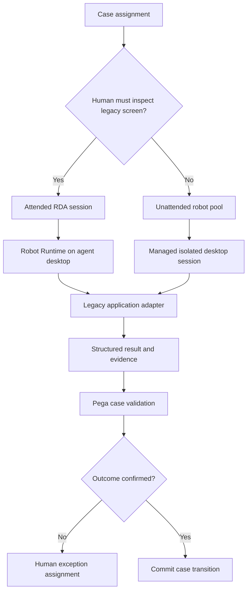

# Robotic Desktop Automation deployment options

## Failure scenario: an attended robot treated like a server
A contact centre automates a legacy policy administration screen through Pega Robot Studio. The desktop automation works for the developer, but deployment to shared virtual desktops produces inconsistent window matching, blocked UI threads and sessions that remain signed into the wrong account after a shift change. Operations propose running the same project as an unattended robot on a shared server. That would change the identity, session and recovery model without solving the brittle screen dependency.

## Choose the execution model first
Robotic Desktop Automation (RDA) assists a human operator in an interactive desktop session. Unattended Robotic Process Automation (RPA) executes in a managed robotic runtime without a person actively driving each step. The choice is not merely whether a Windows window is visible. It determines identity ownership, credential storage, concurrency, desktop isolation, audit attribution, recovery and who is responsible for exceptional cases. Pega Robot Studio and Robot Runtime versions and orchestration features differ across RPA releases; validate the supported deployment pattern for the installed R25 or other target release.

## Design and rollout sequence
1. Map the legacy system's interaction requirements: user gestures, modal dialogs, MFA, browser compatibility, Citrix/VDI behavior, clipboard usage and licensing. If an authenticated API exists, compare it before choosing UI automation. A robot is not a substitute for a stable service contract.
2. For attended RDA, tie automation initiation to a specific Pega assignment and operator context. Give the agent a visible start, progress and cancellation state. Never silently overwrite case fields based on a screen scrape that may refer to another customer.
3. For unattended work, use dedicated service identities with least privilege and isolated runtime sessions. Define credential rotation, MFA compatibility, session expiry and a documented human break-glass path. Do not reuse an agent's interactive password in a robot configuration.
4. In Robot Studio, isolate adapters for the target application and define stable control matching. Prefer supported object identification to coordinate-based clicks. Detect window title, application version and expected account identifier before any write.
5. Design a state machine around the automation: accepted, started, external change attempted, verified, completed or uncertain. An uncertain result must not trigger a blind replay. Return a structured result containing case ID, external reference, operation type and evidence status.
6. Release through a staged desktop deployment ring. Pin compatible Robot Runtime, adapter and legacy application versions. Test cold desktop startup, reconnect, lock/unlock, display scaling and browser update behavior in each supported environment.
7. Keep long-running external calls off the UI thread. Pega's R25 threading guidance warns that synchronous UI and adapter event handlers can block windows; use appropriate asynchronous links and avoid parallel interaction with one desktop application.
8. Add operational ownership: who restarts failed runtimes, who resolves ambiguous writes, how the robot is disabled during a legacy-system outage and how Pega assignments are returned to a human queue.

## Tradeoffs and production failure mechanics
Attended automation offers human oversight and often simpler identity attribution, but agent workstation variability makes support harder. Unattended execution enables scheduling and centralized capacity, yet requires robust desktop lifecycle management and segregation of duties. VDI images standardize runtimes but may hide screen-resolution, session-persistence or accessibility differences. A coordinate-based automation may appear fast until a popup or browser update shifts the control.

Do not classify a successful click as a successful business transaction. Confirm the resulting external record, ideally through a read-only API or a second independent screen state. If the legacy system accepted a payment but the robot crashed before acknowledgment, the case must enter reconciliation rather than repeat the payment. Keep screenshots only when permitted, redacted and time-limited.

## Verification matrix
| Scenario | Setup | Required outcome | Evidence |
|---|---|---|---|
| Agent desktop | Standard interactive login | Correct case/operator mapping | Assignment and robot logs |
| Shared VDI | User logoff and new login | No prior session data exposed | Session reset audit |
| Window change | Alter title/control layout | Safe stop, not wrong-field write | Adapter event trace |
| UI thread stall | Slow external dialog | UI remains responsive or bounded | Runtime thread trace |
| Duplicate start | Start same assignment twice | One active operation | Robot work ledger |
| Crash after write | Terminate runtime mid-transaction | Uncertain state and reconciliation | External reference |
| Credential expiry | Revoke robot identity | Fail closed, alert raised | Auth and case logs |
| Desktop update | New browser/runtime build | Compatibility gate before rollout | Release matrix |

No robot deployment or test result is claimed here. Confirm version-specific RDA and unattended runtime capabilities with the actual product documentation and enterprise security policy.

## Verified Pega references
- [Understanding threading in automations, Pega Robotic Automation R25](https://docs.pega.com/bundle/robotic-automation-r25/page/robotic-automation-r25/threads/understanding-threading.html)
- [Pega Platform '25 Data Page source options including robotic desktop automation](https://docs.pega.com/bundle/platform-25/page/platform/data-integration/changing-data-source-data-page.html?workflow=creating-data-pages)
