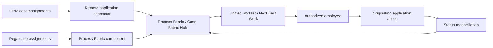

# Federated worklist design and ownership boundaries

**Scope:** Pega enterprise architecture and LSA implementation guidance. Version-dependent configuration and recovery semantics require verification against the target platform release.

## The duplicated task that two teams completed

A bank consolidates loan reviews from a Pega lending application and complaints from a non-Pega service platform into a federated worklist. A loan assignment is reassigned in its source application, but the hub has not yet received the update. Two employees see apparently actionable tasks and both start processing. The hub's list is current enough for navigation but not authoritative for ownership. If it is treated as a second case engine, assignment status diverges and audit trails become contradictory.

Federation should provide a coherent work discovery surface while preserving a single owner for each assignment's lifecycle. The originating application remains authoritative for creation, routing, locking, completion and business state unless an explicit, supported delegation contract says otherwise. The hub is an index and interaction layer, not a replacement for every source workflow.

## Canonical task identity

Define a compound identity: source system, application, assignment ID and version or update token. A bare assignment ID is unsafe because different systems can reuse identifiers. Include owning work queue, assigned operator, case reference, due time, priority, deep-link target and last-synchronized timestamp. The hub may normalize priority for presentation but should not overwrite the source's business priority without a documented contract.

Use Process Fabric Hub or Case Fabric Hub capabilities appropriate to the deployed version. Register Pega applications through the supported Process Fabric component and non-Pega systems through approved connectors and APIs. Preserve a registry of endpoint, authentication, mapping version and ownership. A source adapter must not publish sensitive case details that the hub's user population is not entitled to see.

## Implementation sequence

1. Catalogue the source applications, assignment classes, work queues and operator directories. Identify whether each source supports event publication, polling, completion APIs and deep links.
2. Define a canonical task schema and map source status values to visible states. Keep raw source status for reconciliation; avoid lossy transformations such as mapping every non-open state to Completed.
3. Configure application registration and connector credentials. Use least-privilege service identities and secure endpoint configuration; separate hub user identity from connector credentials.
4. Synchronize assignments using supported hub mechanisms. Include stable compound IDs and update versions so repeated events do not create duplicate rows.
5. At task open, revalidate the user's access and retrieve current assignment status from the source. If it has moved, refresh the hub and explain the change instead of presenting a stale action.
6. Execute completion through the source application's supported API or navigational handoff. Respect source locking and concurrency semantics. Record an acknowledgement before marking the hub row complete.
7. Reconcile missing or delayed events by comparing source and hub state. Maintain a bounded retry queue and alert on sustained synchronization lag.
8. Define ownership of support incidents. A source assignment failure belongs to the source team; a connector or synchronization defect belongs to the federation platform team.
9. Pilot with two systems and a small work queue before expanding to all case types. Track stale-open tasks, duplicate displays and rejected actions.

## Tradeoffs

A central worklist reduces application switching but adds a dependency and eventual consistency. Polling is easier to implement where events are unavailable, but increases load and produces freshness gaps. Event-based synchronization improves responsiveness but requires deduplication, replay and ordering controls. Rendering all task details centrally gives a richer experience but expands data residency and authorization scope. Deep linking keeps sensitive work in the source application but may require separate authentication and disrupt the user experience.

## Production failure mechanics

If an event arrives out of order, an older Open state can overwrite a newer Completed state unless the connector enforces source versions. If a user is removed from a work queue while the hub session remains active, the hub may continue to show the assignment. Always reauthorize on action at the source. During source outage, label rows as stale and disable unsafe completion actions. Do not delete task history merely to make a lag metric appear healthy.

## Reproducible verification matrix

| Scenario | Steps | Expected behaviour |
| --- | --- | --- |
| Same ID in two sources | Publish assignment 123 from both systems | Two distinct compound identities |
| Reassignment | Move task in source before hub refresh | Old operator cannot complete it |
| Duplicate event | Replay same assignment update | One hub row |
| Out-of-order events | Send Completed then older Open | Completed state retained |
| Source outage | Disable completion endpoint | Stale warning and safe retry |
| Access revocation | Remove operator from source work queue | Hub cannot authorize action |
| Reconciliation | Drop one event then run sync | Source and hub converge |

This is an architecture test specification, not an assertion that synchronization has been exercised. Verify connector and task support for the exact Process Fabric or Case Fabric Hub version.

## Primary reference

- [Pega Academy: Process Fabric Hub for the enterprise](https://academy.pega.com/topic/pega-process-fabric-hub-enterprise/v5/in/96936/97086)

## Architecture flow

## Evidence required before production approval

Attach a reviewed architecture decision, application and Pega release versions, rule identifiers, sanitized test evidence, observed results, open risks and rollback criteria. The matrix is a design-backed verification plan rather than a claim of completed laboratory testing.
