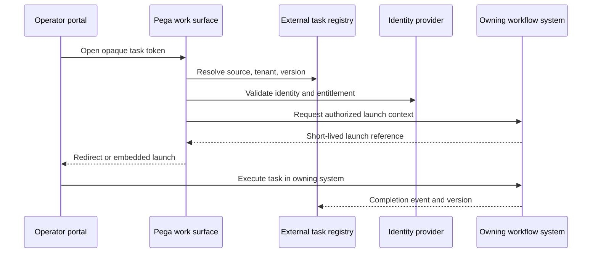

# External assignment identity and deep linking

**Audience:** Pega Lead System Architects and platform engineers. Design guidance is not a claim of laboratory validation.

A bank aggregates customer onboarding work from Pega and a separate document-verification platform into one operator portal. The portal displays a single task list, but a link to an external task is built from a guessed numeric assignment ID. After the external system rotates its identifiers, an agent clicks a task and lands on another customer's record. The worklist was synchronized, but task identity, authorization and navigation were not designed as contracts.

A federated assignment is a reference to work owned elsewhere. It is not a Pega assignment that can be completed by updating a local status property. The owning platform controls task validity, permissions, transitions and completion acknowledgement.

## Identity and routing contract

Create an external work reference with SourceSystem, SourceTenant, ExternalTaskID, ExternalCaseID, ExternalTaskVersion, OwnerGroup, TaskType, DisplayStatus, LastSyncedAt and NavigationMode. Define a globally unique composite key, not a display label or an integer task number. Use opaque public tokens in links and resolve them server-side to the current task reference.

If using Pega Process Fabric or an external work aggregation capability, verify its exact version, supported source connectors and identity semantics. Do not assume every source supports assignment actions through the aggregator. A unified list may be read-only while execution takes place in the owning system.

## Implementation sequence

1. Catalogue external sources and identify the owning system for each task type. Document whether the integration supports discovery only, deep linking, or full action execution.
2. Define an external task data class and stable composite identity. Include a source-system namespace and tenant boundary. Never merge records on title, customer name or a display case number.
3. Use a data page or integration service to load a current task summary. Configure refresh, TTL and invalidation based on source change events. A cached task summary is not proof the task is still assigned.
4. On click, call a Pega service or case action that validates the operator's current entitlement and resolves the external reference. Do not embed permanent external bearer tokens in the URL.
5. Establish identity federation through a supported SSO protocol, using the external system's authorization decision at launch. A Pega access group cannot substitute for an external application's own permission check.
6. Prefer short-lived, single-use launch references or source-generated URLs with server-side validation. Define behavior when the source cannot issue a secure deep link.
7. Route the operator to the external system without leaking personal data in URL query strings, browser history or referrer headers. Validate allowed redirect destinations to prevent open redirects.
8. Consume completion events idempotently with SourceEventID and ExternalTaskVersion. If polling is required, reconcile task status and preserve out-of-order event handling.
9. Show a clear stale-task experience when an assignment was completed or reassigned after list retrieval. Refresh the row rather than allowing a second completion.
10. Add telemetry for link resolution, authorization denials, source timeouts and completion-lag by source, with opaque task references.

## Tradeoffs

Server-side redirect resolution adds a network hop but allows revocation, audit and stable links when external IDs change. Direct source URLs reduce latency but risk token leakage and brittle deep links. Mirroring external assignments as full local Pega work objects may enable uniform routing, but creates duplicate ownership and difficult synchronization. Prefer references unless a deliberate delegated ownership model is agreed.

## Production failure mechanics

A source task is reassigned while its stale summary remains in Pega. The user still sees it, but the owning system must deny execution. Another failure occurs when a completion event arrives before the initial discovery event: an insert-only consumer can resurrect a completed task. Use monotonic source versions or a reconciliation query before changing status. When the identity provider session expires, a redirect may return the operator to the wrong portal context; preserve only an opaque return token and revalidate it after authentication.

## Reproducible verification matrix

| Scenario | Execution | Expected result |
| --- | --- | --- |
| Colliding task IDs | Same numeric ID from two sources | Distinct references |
| Revoked source access | Remove source role after task listing | Launch denied |
| Reassignment | Change task owner before click | Stale row refreshed |
| Expired launch token | Delay redirect past expiry | Reauthentication, no access leak |
| Malicious return URL | Inject external redirect target | Destination rejected |
| Out-of-order completion | Deliver completion before discovery | No task resurrection |
| Duplicate completion | Replay source event | One logical status change |
| Source outage | Disable owning system | Task remains pending with clear error |

**Primary reference:** [Pega Platform: more about Service REST rules](https://docs.pega.com/bundle/platform-23/page/platform/data-integration/more-about-service-rest-rules.html). Process Fabric and external work integration contracts must be confirmed for the installed product versions.
