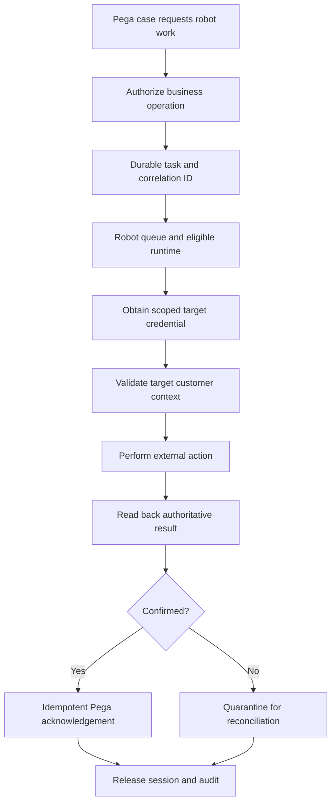

# Robotic runtime identity and unattended execution
## Failure scenario
A utility provider automates meter correction in a legacy desktop application. A Pega case queues work for an unattended robot. The bot signs in with a shared operator credential that also has permission to approve refunds. When a Windows session is recycled, the robot resumes a partially completed task under a different desktop session. It repeats the external update and returns success to Pega even though the wrong customer account was modified. The problem is not simply unreliable UI automation; it is missing identity, execution ownership and acknowledgement boundaries.

## Identity is not one account
Distinguish the Pega case requestor, Queue Processor or robotic assignment, Robot Manager identity, runtime host identity, target application credential and human support operator. These principals need different privileges and audit trails. A case worker's access group should not be copied wholesale to the robot, and a shared administrator account should not be used for a target application's unattended tasks.

In Pega implementations that integrate robotic automation, a case may use an Assign to robot queue shape, and a Data Page can consume robotic automation results with explicit timeout and request/response Data Transforms on supported versions. The exact orchestration and credential handling depend on the installed Pega Robotics and Robot Manager versions. Do not assume a desktop automation runs transactionally with the Pega case database.

## Engineering implementation
1. Inventory every principal, privilege, secret, certificate and execution host in the automation chain. Assign a dedicated Pega robotic integration role with only the case operations it requires, and a separate target-system service identity with least privilege.
2. Define the business command as an immutable task: `CaseID`, `OperationType`, `TargetAccountID`, `CommandID`, expected version and expiry. Keep credentials and sensitive payloads out of the queued record. Use a server-side mapping Data Transform to create the robot request.
3. Configure robot queues and runtimes according to the deployed Robot Manager and Pega Robotics version. Constrain which machines may execute which operations, and ensure session health, licensing and desktop prerequisites are checked before dispatch.
4. Retrieve target-system credentials from an approved vault at execution time. Rotate and revoke independently of Pega user passwords. Prevent secrets appearing in logs, screenshots, clipboard or exception traces.
5. Before each external write, verify the visible target account against the immutable task ID and expected customer attributes. UI focus or window title alone is insufficient. Abort if the application navigated to a different record.
6. Record a durable command status: pending, leased, attempted, externally confirmed, acknowledged or uncertain. These are proposed application states, not guaranteed built-in Robot Manager statuses. Lease expiry must not imply the external operation never happened.
7. Implement an idempotency check at the external target where possible. If the legacy UI offers no idempotency key, read back the transaction and route ambiguous outcomes to human reconciliation rather than blindly retrying a write.
8. On successful read-back, acknowledge the Pega assignment once using the command ID and case-lock checks. If the Pega acknowledgement fails after an external success, preserve evidence for safe replay of the acknowledgement only.
9. Isolate robot runtime operating-system identities, restrict interactive logon and remote access, and audit emergency support sessions. Enforce host patching and a controlled rollout process for desktop UI changes.
10. Monitor robot availability, lease age, task attempts, reconciliation backlog and target-system error types. Keep business identifiers pseudonymized in shared telemetry.

## Tradeoffs and failure mechanics
A dedicated credential per robot improves attribution but increases credential administration. A shared low-privilege target account is simpler but may obscure which execution performed an action. Screen-based automation can be the only available integration, yet it is inherently more sensitive to display changes than an API. An API replacement should be considered when it offers stronger transaction identity and read-back guarantees.

The critical ambiguity is an external write that succeeds while the robot crashes before Pega receives confirmation. Automatically requeuing the command can create a duplicate correction. A second failure is reusing a Windows session with stale target-application authentication. Validate identity at each operation boundary, not only at startup.

## Verification matrix
| Test | Fault | Required result | Evidence |
|---|---|---|---|
| Wrong account | Switch target UI record | Write blocked | Context check log |
| Secret revoked | Disable vault credential | No fallback to shared admin | Authentication audit |
| Crash after write | Kill runtime before acknowledgement | Task marked uncertain | External read-back |
| Duplicate task | Deliver same command twice | At most one business effect | Command ledger |
| Stale session | Reuse logged-in desktop | Revalidation required | Runtime session audit |
| Role reduction | Remove robot permission | Command denied | Pega authorization |
| UI change | Rename target control | Safe failure and escalation | Error classification |

These are design-backed laboratory tests. Validate Robot Manager and Pega Robotics feature support against the exact installed versions.
## Verified primary guidance
- [Creating a Data Page, Pega Platform '25, including robotic automation source](https://docs.pega.com/bundle/platform-25/page/platform/data-integration/creating-data-page.html?workflow=creating-data-pages)
