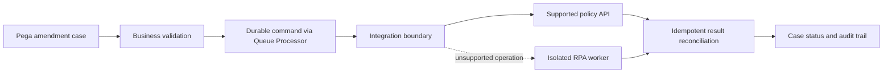

# When to replace RPA with a stable API

> Original architecture design study. The enterprise scenario is illustrative; no test execution or measured result is claimed.

## Enterprise failure scenario

An insurance administrator uses unattended desktop robots to copy policy amendments from a Pega case into a legacy policy system. The robot opens a desktop form, selects a customer, types a premium and clicks Save. A vendor patch renames a control and a robot retries the whole transaction after a timeout. The first attempt may already have committed, so the second attempt creates a duplicate amendment. The vendor now offers a supported authenticated API. The migration decision must account for semantics, auditability and recoverability rather than treating an API as merely a faster way to press the same buttons.

## Architecture and Pega-specific configuration decisions

Prefer a supported, contractually governed API when it provides the required operation and its business semantics are understood. Keep the Pega case as the workflow authority and the policy platform as the policy system of record. Encapsulate the integration behind a data or integration boundary: Connect REST, authentication profile, request/response Data Transforms and a Data Page for reads. Use a Queue Processor for durable asynchronous writes where business timing allows. Keep a correlation ID and idempotency key across retries. Retain RPA only for unsupported operations and isolate its runtime identity and workstation dependencies.

## Technical flow

## Step-by-step implementation

1. Inventory every robotic action and classify it as read, mutation, navigation or human judgment. Record business purpose, source system, data owner and current exception handling.

2. Compare the API contract with the robot's real workflow, including hidden validation, save semantics, permissions, status transitions and business identifiers. Do not assume a POST call reproduces a multi-screen transaction.

3. Define an integration command such as AmendPolicy with a unique business command ID, policy identifier, requested effective date and expected version. Validate this payload in a Pega Data Transform before dispatch.

4. Configure Connect REST and the appropriate authentication profile. Keep credentials in approved platform-managed configuration; do not embed service passwords in activities or clipboard properties.

5. Choose synchronous processing only for operations that fit the case interaction deadline. For slower mutations, queue a durable request and show a PendingExternalUpdate state with an explicit timeout and escalation policy.

6. Implement safe retry semantics: use a provider idempotency key if available; otherwise query the authoritative system before replaying a possibly completed mutation. Treat network timeout as unknown outcome, not automatic failure.

7. Run the API and robot paths in a controlled shadow comparison without issuing duplicate production writes. Compare resulting policy state, audit records and validation errors using sanitized fixtures.

8. Retire the robot step only after contractual API support, monitoring, access review, rollback, support ownership and an operational runbook have been approved.

## Production failure mechanics

A successful HTTP response can represent acceptance into a downstream queue rather than completed policy mutation. A retry after a lost response can duplicate a financial adjustment. API schemas can be stable while business rules change behind them; contract tests must include semantic outcomes. Robot runtime failures depend on screen resolution, desktop focus, session expiration and application version. An API replacement removes those UI dependencies but introduces authentication expiry, rate limits, schema drift and gateway availability. A mixed-mode deployment must never allow both paths to execute the same command independently.

## Engineering tradeoffs

An API offers explicit contracts, predictable error codes and service observability, but may not expose every operation available in the UI. RPA can bridge an unmodified legacy system quickly, yet maintenance and credentials become long-term operational liabilities. A dual-path transition reduces cutover risk but doubles reconciliation complexity. Keep the fallback deliberate and time-limited, not a permanent ungoverned second writer.

## Reproducible verification matrix

| Test stimulus | Expected evidence and acceptance criterion |
| --- | --- |
| API times out after downstream commit | Reconciliation finds existing command; no duplicate amendment |
| Provider returns accepted but not complete | Case remains pending until authoritative confirmation |
| Robot UI selector changes | Robot path fails safely; case routes to exception |
| API returns validation conflict | No blind retry; business correction requested |
| Both paths enabled in migration | Single command ownership prevents double execution |
| Credential expires or API throttles | Bounded retry and operational alert without data loss |

For every matrix row, capture the target Pega version, input fixture, operator or service identity, expected outcome, actual persisted state and correlated logs. Test negative paths using isolated non-production records. These are planned tests, not executed results.

## Release and evidence constraints

Pega Academy describes RPA as useful when a target system lacks an accessible API and explains attended and unattended integration patterns. Exact Pega Robotic Automation product support, connector options and Queue Processor behavior are version dependent. Document the deployment dependency graph, security review, rollback boundary and operational owner before production adoption. A passing UI demonstration is not sufficient evidence of correct persistence, authorization or idempotency.

## Verified primary source

- [Pega Academy guidance](https://academy.pega.com/topic/pega-and-robotic-automation-integration-overview/v1)
