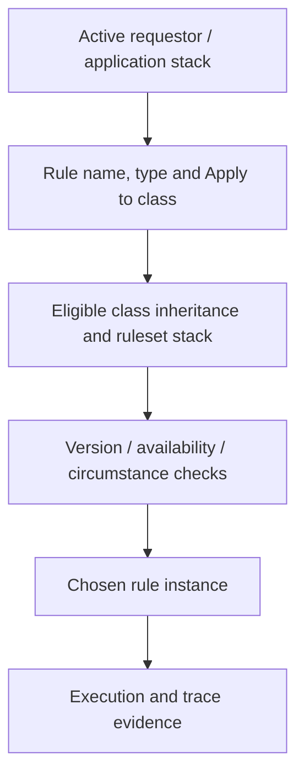

# Rule Resolution in Multi-Layer Applications: Why the Wrong Rule Executes

**PFA-016** | **Audience:** Senior and Lead System Architects | **Status:** Reference architecture; live Pega test pending

A case works in the framework application but executes a different decision in the implementation layer. The fix is understanding rule context, not copying more rules.

## 1. The enterprise failure this design prevents

An insurer has a reusable Claims framework and two implementations, UKClaims and EUClaims. A decision named DetermineRoute works in the framework ruleset. After a new implementation version is deployed, UKClaims unexpectedly routes high-value cases to the generic queue. The engineer sees a rule with the expected name in Dev Studio and assumes it must run. In Pega, the name alone does not determine runtime selection. The **Apply to class, ruleset stack, rule type, version, availability, circumstance and context** all affect resolution. The precise eligible candidate set must be verified for the active requestor and deployed version.

## 2. Component and execution architecture

The following diagram is an **illustrative reference design**. It is not a screenshot from a running Pega environment.

## 3. Which Pega objects own each concern?

| Component | Why it exists |
|---|---|
| `ClaimsFW-Work-Claim` | Shared case base class and default routing |
| `UKClaims-Work-Claim` | Implementation class with business specialisation |
| `DetermineRoute` | When or Decision Table used by an illustrative routing flow |
| `ClaimsFW:02-01-01` | Framework ruleset version |
| `UKClaims:03-02-01` | Implementation ruleset version |
| `Application / Access Group` | Defines context of eligible rulesets at runtime |

The named objects above are a mix of actual Pega rule categories and illustrative application-specific names. They are not a claim that all such rules exist in a default Pega installation.

## 4. Implementation design and decision sequence

1. Write down the actual primary page class when the flow calls DetermineRoute. A developer's open-rule browser context can differ from the runtime context.

2. Inspect the operator's active access group, application stack and resolved ruleset versions. Include built-on applications rather than only the local ruleset.

3. Capture the candidates with the same name and type in each relevant inheritance class. Mark withdrawn and blocked instances rather than ignoring them.

4. Check the eligible rule versions and circumstance conditions. Do not assume that a rule in a newer version will always win regardless of other eligibility criteria.

5. Use a controlled case run and Tracer to identify the rule instance actually executed. Preserve class, ruleset and version evidence.

6. Refactor unnecessary implementation overrides into a narrower circumstance or intentional extension point if the feature can be expressed without duplicating the whole rule.

## 5. What an architect must choose

| Approach | Effect and trade-off |
|---|---|
| Copy the entire framework decision into each implementation | Fast local change but high drift and upgrade risk |
| Use focused implementation override | Clear ownership when country-specific logic genuinely differs |
| Use circumstance or reusable extension design | May reduce duplication, but increases need to test precedence and runtime context |

**Decision standard:** choose the smallest design that satisfies consistency, auditability, security, performance and operational recovery, not the design that simply looks easiest in Dev Studio.

## 6. Failure modes and root-cause investigation

**Failure 1, unexpected inheritance:** The case is instantiated under a more specific class than expected. Inspect the runtime class hierarchy and application ruleset list before editing the decision. **Failure 2, blocked/withdrawn candidates:** A rule that appears present in the repository may not be eligible at execution. **Failure 3, stale interpretation:** A rule opened in Dev Studio is not proof of runtime selection. Capture a trace of the failing case with the operator's real access group. **Failure 4, deep override chains:** Four implementations duplicate the same table, hiding a framework fix. Build a cross-application comparison and remove only verified redundancy.

For troubleshooting, preserve the application/ruleset version, access context, precise business identity, timestamp and correlation ID. Never include secrets or production customer documents in publicly shared traces.

## 7. Verification matrix for a Pega lab

These are **tests to run**, not tests that have already passed.

| Experiment | Evidence and expected assertion |
|---|---|
| Framework test | Run a ClaimsFW case and record actual rule key and output |
| UK variant | Run UKClaims with a matching value; verify intended implementation |
| EU variant | Run EUClaims with the same input; verify intended difference |
| Upgrade regression | Add an eligible newer framework version in test; determine whether the implementation still selects its intended rule |
| Negative availability | Exercise a withdrawn/blocked candidate in a disposable ruleset and document actual precedence |

At the end of the experiment, attach redacted screenshots of the relevant rule forms, Clipboard/Tracer/PAL evidence when applicable, and an actual observed outcome. If any result differs, update the design instead of changing the evidence description.

## 8. Production readiness and ownership

Keep an ADR for every deliberate implementation override: owner, reason, expected class context and removal criteria. Put regression cases for each implementation in the release test suite. Avoid modifying production rule versions merely to make one operator's trace pass.

**Architecture acceptance:** the design has an explicit owner, a version-specific reproducible test, a failure/recovery procedure, the relevant security controls and a way to detect regressions.

## 9. Product references and limitations

- [Pega Academy: Rule resolution](https://academy.pega.com/topic/rule-resolution/v7)
- [Pega legacy reference: Rule resolution](https://community.pega.com/sites/pdn.pega.com/files/help_v84/concepts/concepts2/howruleresolution.htm)

Pega functionality changes by release. Treat exact editor labels, extension points and service behaviours as version-sensitive until verified in the target environment. This independent article is neither an official Pega document nor a claim of an executed customer implementation.
