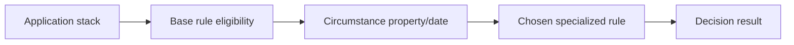

# Circumstancing across regions and business lines

**PFA-017** | Pega SSA/LSA engineering study | Reference architecture, not yet lab-tested

## Incident that exposes the design

A lender needs a different affordability threshold for one jurisdiction only during a regulatory transition. Copying the whole decision table into every country branch creates long-lived divergence. Pega circumstancing can select targeted variations by property or date, but it participates in rule resolution and must be tested with class and ruleset context.

The architecture review must determine who owns the state, what survives retries, and whether the rule or infrastructure boundary actually enforces the expected behavior.

## Runtime path

## Pega-specific assets to inspect

1. **Circumstanced Decision Table**. Establish the actual application/ruleset version, the responsible operator or runtime node, and where diagnostics for this component are captured.
2. **Ruleset versions**. Establish the actual application/ruleset version, the responsible operator or runtime node, and where diagnostics for this component are captured.
3. **Apply To class**. Establish the actual application/ruleset version, the responsible operator or runtime node, and where diagnostics for this component are captured.
4. **case jurisdiction property**. Establish the actual application/ruleset version, the responsible operator or runtime node, and where diagnostics for this component are captured.

## Reference implementation

1. Keep the base decision valid and express the smallest jurisdictional difference in the eligible circumstance.

2. Separate policy-effective date from server timestamp; decide whether rule eligibility uses case event date or current runtime date.

3. Use a trusted jurisdiction property, not an editable UI string that could choose a more permissive rule.

4. Trace the resolved rule key across all jurisdictions and the day before/after date boundaries.

5. Retire expired circumstances explicitly and test old cases that resume after an effective-date transition.

## Decision and trade-off

- **Option 1:** Copy whole rule offers local freedom but high divergence.
- **Option 2:** circumstance keeps a common rule but precedence is subtle.

The selection belongs in an architecture decision record with affected system boundaries, non-functional acceptance criteria and an identified production owner.

## Failure diagnosis

Failure: a circumstance in an ineligible ruleset is never chosen, or multiple overlapping dates produce surprising candidates. Inspect the selected rule, not only output.

For a reproducible incident, retain the affected case or operation ID, timestamp, effective ruleset stack, requestor/node, downstream correlation ID where appropriate, and the actual failing transition. Never publish live client records or authorization tokens.

## Validation experiments

1. **Test 1:** Test jurisdiction A/B with identical input. Record the precise input, expected outcome, observed server behavior and available evidence.
2. **Test 2:** test transition midnight and resumed old case. Record the precise input, expected outcome, observed server behavior and available evidence.
3. **Test 3:** test unknown jurisdiction fallback. Record the precise input, expected outcome, observed server behavior and available evidence.

These are proposed verification experiments. No screenshot or performance result is presented as a completed run. Test on the actual installed Pega release, and record deviations from the pattern.

## Operations and production decision

Set operational alerts on the failure signal described above, not merely application health. Document how the team can retry, reconcile or repair the business transaction without duplicating remote effects. If deployment changes rules, schemas or identity policies, test active cases and queued operations crossing the release boundary.

## Documentation

- [Pega Academy: Rule specialization](https://academy.pega.com/topic/ruleset-class-and-circumstance-specialization/v3)

*Independent technical design. Fictional scenario. Verify version-specific functionality in your own environment.*
