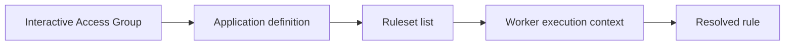

# Access group and application stack resolution context

**PFA-018** | Pega SSA/LSA engineering study | Reference architecture, not yet lab-tested

## Incident that exposes the design

An interactive operator executes a newer flow action while a Queue Processor appears to run its older logic. Both refer to the same rule name but have different effective application contexts. Access Group is not just a login destination; it influences the ruleset stack and eligible rules.

The architecture review must determine who owns the state, what survives retries, and whether the rule or infrastructure boundary actually enforces the expected behavior.

## Runtime path

## Pega-specific assets to inspect

1. **Operator ID and Access Group**. Establish the actual application/ruleset version, the responsible operator or runtime node, and where diagnostics for this component are captured.
2. **Rule-Application**. Establish the actual application/ruleset version, the responsible operator or runtime node, and where diagnostics for this component are captured.
3. **Ruleset list**. Establish the actual application/ruleset version, the responsible operator or runtime node, and where diagnostics for this component are captured.
4. **Queue Processor runtime access**. Establish the actual application/ruleset version, the responsible operator or runtime node, and where diagnostics for this component are captured.

## Reference implementation

1. Capture and compare the full effective ruleset lists of the operator and background processing requestor, not merely their visible app names.

2. Record the targeted primary page class and relevant rule type, since rule resolution also uses inheritance and name/type.

3. Align worker runtime context with the intended application version while keeping least-privileged background access.

4. Test all critical decision rules under both interactive and headless requestors as part of deployment.

5. Do not solve a missing rule by giving the worker broad administrative access; fix the application stack or component dependency.

## Decision and trade-off

- **Option 1:** Single shared access group reduces drift but may overprivilege workers.
- **Option 2:** purpose-specific worker group is safer with explicit version checks.

The selection belongs in an architecture decision record with affected system boundaries, non-functional acceptance criteria and an identified production owner.

## Failure diagnosis

Failure: the worker uses a shared generic application context missing recent implementation rules, so events are processed with outdated policy.

For a reproducible incident, retain the affected case or operation ID, timestamp, effective ruleset stack, requestor/node, downstream correlation ID where appropriate, and the actual failing transition. Never publish live client records or authorization tokens.

## Validation experiments

1. **Test 1:** Trace same rule under operator and worker. Record the precise input, expected outcome, observed server behavior and available evidence.
2. **Test 2:** compare ordered stack. Record the precise input, expected outcome, observed server behavior and available evidence.
3. **Test 3:** remove component ruleset in test and observe error. Record the precise input, expected outcome, observed server behavior and available evidence.

These are proposed verification experiments. No screenshot or performance result is presented as a completed run. Test on the actual installed Pega release, and record deviations from the pattern.

## Operations and production decision

Set operational alerts on the failure signal described above, not merely application health. Document how the team can retry, reconcile or repair the business transaction without duplicating remote effects. If deployment changes rules, schemas or identity policies, test active cases and queued operations crossing the release boundary.

## Documentation

- [Pega Academy: Ruleset list](https://academy.pega.com/topic/ruleset-list/v6)

*Independent technical design. Fictional scenario. Verify version-specific functionality in your own environment.*
