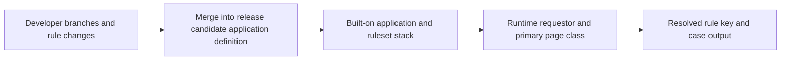

# Ruleset Versions Across Parallel Teams: Preventing Runtime Drift

**PFA-019** | **Audience:** Senior and Lead System Architects | **Status:** Architecture design, live Pega verification pending

## The actual failure

Two teams independently change a shared routing decision in application branches. Each team passes a local unit test but production executes a different version after merging. The rule's name is the same; the active application stack, class context and eligible ruleset version are not. A branch is a development workspace, not proof of the final candidate for runtime rule resolution.

## System interaction and ownership

This is a conceptual reference architecture, not a product screenshot or observed runtime trace. Its boundaries must be verified for the actual Pega deployment version and external systems.

## Pega implementation inventory

| Component or rule | Design consideration |
|---|---|
| Rule-Application definition | Owns a defined runtime decision or state boundary |
| Rule-Ruleset-Version | Needs a documented input/output contract |
| Ruleset branches | Requires version-specific access and execution testing |
| Rule-Admin-Product package | Produces diagnostics for failure isolation |
| Tracer and PegaUnit regression suite | Carries operational ownership |

## How to implement and validate the architecture

1. Capture a version manifest for each release, including built-on applications, locked rulesets and intentionally overridden rules.

2. Build and test a fixed release candidate rather than using the changing ruleset stack of individual developers.

3. For a shared decision rule, record the primary page class, candidate rule classes, circumstances, availability and resolved rule key.

4. Design extension points rather than copying whole rule trees into every implementation application.

5. Test under the background worker access group as well as the interactive operator. Both can have different effective contexts.

6. Prepare a backward-compatibility assessment for long-running cases and queued work that may resume after promotion or rollback.

For a production build, annotate the actual class names, access group, ruleset version, node role and recovery owner. Ensure each external operation has an explicit system of record; a successful Pega case save does not, by itself, certify that an external service committed a change.

## Architectural choices

| Pattern | Consequence |
|---|---|
| Copy shared rule into every implementation | Easier local edits but high divergence and regression scope |
| Versioned shared component with narrow overrides | Strong reuse when rule context and release dependencies are governed |
| One mutable shared ruleset for all teams | Fast merges but unsafe simultaneous delivery |

Choose by the actual confidentiality, scale, consistency and failure-recovery constraints. A seemingly quicker configuration can shift cost into production support, data repair or lost auditability.

## Failure mechanics and support diagnosis

A newer but ineligible rule may not execute. A blocked or withdrawn instance affects candidate selection. A copied implementation rule can conceal a framework fix. Trace the exact failing requestor, application version and class context rather than opening a similarly named rule in Dev Studio.

Correlate one affected case ID and operation ID across rule execution, logs and dependent services. Record the effective application/ruleset versions and node. Avoid exporting live client data or confidential prompts in community evidence.

## Test matrix

| Test | Expected verification |
|---|---|
| Experiment 1 | Run the same case with two access groups and compare resolved rule key. |
| Experiment 2 | Merge conflicting decision edits in test; confirm intended table outcome. |
| Experiment 3 | Use a long-running case created before the release and resume its assignment. |
| Experiment 4 | Run queued activity under the deployed application stack and verify rule selection. |

These are **experiments to execute**, not assertions of a completed test. Include Pega configuration screenshots and sanitized Clipboard, Tracer, PAL or service evidence only after an authorised lab run. A failing experiment is valuable evidence and should update the design.

## Release and production readiness

Before promoting the design, confirm: observable business state; retry and rollback constraints; tenant and privilege isolation; capacity target; accountable support team; release-specific configuration; and a documented repair procedure. A green rule test or a running node does not imply the complete business operation succeeded.

## Primary reference

- [Pega Academy technical documentation](https://academy.pega.com/topic/application-structure/v5)

This article is an independent architectural study. The example scenario is fictional. It is not affiliated with Pegasystems, and no performance measurement or live test result is claimed.
