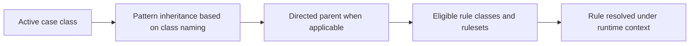

# Pattern versus Directed Inheritance: Designing Rule Reuse Without Ambiguous Class Resolution

**PFA-020** | **Target reader:** Pega SSA / LSA | **Evidence:** Architecture design, live test pending

## Why this matters in a real enterprise application

An insurer develops a reusable DocumentValidation capability under Acme-Claims-Work. After another acquired business builds Acme-Lending-Work, engineers copy the rule into Lending because the inheritance chain does not expose it. A proposal to reparent classes under Claims would introduce incorrect business semantics. The architectural issue is what should be reused by naming hierarchy and what requires an explicit, stable parent.

The technical target is not simply to configure a rule that works once. The design must remain correct when authorization changes, multiple requestors interact, dependent services fail and different rule versions coexist during deployment.

## Runtime architecture and trust boundaries

The diagram is an implementation proposal, not a screenshot or observed runtime trace.

## Pega rule and component inventory

| Pega component | What the architect must control |
|---|---|
| Class definition: Applies To and directed parent | Define the component's business ownership and version |
| Ruleset and application stack | Specify input fields, classes and caller contract |
| Common Data/Int capability class | Confirm scope, access privileges and applicable rulesets |
| Business-specific implementation class | Expose useful diagnostic evidence and correlation IDs |
| Tracer and Rule Resolution diagnostics | Define failure/recovery behavior and verification owner |

All custom names in the example should be replaced with classes and rule names from the target application. Do not blindly apply design examples to a different Pega release.

## Implementation design

1. **Step 1:** Draw the exact class names and pattern parents before selecting an inheritance design; do not infer them from class labels in App Studio.

2. **Step 2:** Reserve pattern inheritance for rules that conceptually belong at a shared business level. Example: Acme-Claims-Work-Auto inherits reusable Claims rules through its name hierarchy.

3. **Step 3:** Use directed inheritance when the class requires rules from a parent that cannot be represented naturally by its name hierarchy, but keep that parent narrow and stable.

4. **Step 4:** Avoid pointing a Lending case directly at the Claims implementation simply to reuse one validation. Extract a neutral component or shared capability, with an explicit contract.

5. **Step 5:** Confirm the rule class and runtime primary page class when the inherited rule executes. Some rules require properties that do not exist in the newly inheriting class.

6. **Step 6:** Review ruleset versions and availability. A correctly inherited class still cannot resolve a candidate excluded by the active application stack.

7. **Step 7:** Test inherited rule selection with the implementation's real Access Group and with a background worker, not only a developer's Run Rule context.

### Decision contract

Before writing the rule, record the caller, authoritative system of record, access-group or service identity, acceptable stale age, latency target and required behaviour under duplicate execution. Where the feature supports multiple execution modes, the choice must be justified against these constraints.

## Alternative patterns

| Design approach | Why it may or may not fit |
|---|---|
| Pattern inheritance | Clear organizational taxonomy and natural reuse along class prefix hierarchy |
| Directed inheritance | Explicit non-naming parent and reuse across branches, but hidden dependencies can complicate tracing |
| Explicit component service or Data Page contract | Decouples class inheritance when only one capability is shared, with extra interface design |

A more scalable option is not necessarily the most secure or operationally supportable. The decision should be driven by the application's actual workload and failure modes, not the convenience of one dev-environment demo.

## Production failure and diagnosis

A rule can resolve but fail at execution because its referenced property is not part of the target class. An overly generic directed parent may expose unrelated rules and create nonobvious overrides. A copied rule can shadow a later framework fix. Inspect the selected Rule key and inherited class list in Tracer, and capture a release-specific ruleset manifest.

When diagnosing a failure, capture the exact case ID in an approved test environment, the active application and ruleset versions, Pega node, relevant Data Page or flow state, and the downstream correlation ID. Avoid including tokens, customer personal information or confidential attachments.

## Verification plan

| Scenario | Evidence required |
|---|---|
| Experiment 1 | Resolve one shared validation in two implementation classes and capture exact rule key. |
| Experiment 2 | Add a more specific implementation override and prove intentional precedence. |
| Experiment 3 | Withdraw or disable an eligible test rule and record fallback behavior. |
| Experiment 4 | Execute the rule from a Queue Processor access group and compare runtime context. |

**These are test instructions, not completed test results.** Once a supported Pega sandbox is available, record the installed release and attach redacted, authentic rule screenshots, Tracer/PAL or Clipboard evidence and expected versus observed outcomes.

## Operational acceptance and release considerations

Specify an accountable owner for this design, expected business volume, Pega and dependent-system resource limits, monitoring signals and a recovery runbook. Confirm an older persisted case or queued operation can safely resume after deployment where applicable. Create an Architecture Decision Record so future maintainers understand both the accepted approach and its rejected alternatives.

## Primary references and version caveat

- [Pega Academy: Rule reuse through inheritance](https://academy.pega.com/topic/rule-reuse-through-inheritance/v6/in/52316/53116)

This independent article is based on published Pega concepts and a fictional scenario. UI labels, exact method semantics and feature availability must be verified in the chosen platform release.
