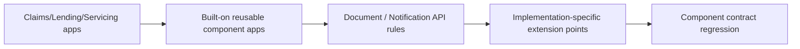

# Reusable Component Applications: How to Share Rules Without Creating Another Pega Monolith

**PFA-021** | **Audience:** Pega SSA / LSA | **Lab status:** Not yet executed in a live Pega environment

## Enterprise problem

Claims, Lending and Servicing applications all need document classification and notification delivery. The platform team proposes one giant EnterpriseFramework for everything. Six months later a minor notification template change forces a full regression of all cases because the framework has broad ruleset dependencies and shared overrides. A better component design exposes stable input/output contracts and keeps consuming case policy local.

The purpose is to decide how Pega should behave when there are simultaneous users, service failures, stale state and a deployment boundary. A feature can be configured correctly at rule level but still be wrong for the business process.

## Component and runtime sequence

This is a conceptual design. It is not a claim about actual traces or a particular Pega version.

## Pega artefacts and execution context

| Rule or component | Design requirement |
|---|---|
| Rule-Application with built-on applications | Architectural responsibility and identity boundary |
| Component Rulesets | Rule or configuration must be version controlled |
| Data Pages / service or flow interfaces | Inputs/outputs and failure model must be documented |
| Application Validation mode | Expected observability and support ownership |
| Component PegaUnit suite | Explicit integration or release validation required |

Before implementation, record the actual Apply To class, ruleset and access group. Business responsibility must remain with the correct system of record. Context supplied through UI request parameters should be treated as untrusted until server-side authorization is applied.

## Technical implementation sequence

1. Inventory actual shared calls, not just similarly named rules. Separate reusable capability from domain policy.

2. Build the component as a stable bounded capability, e.g. D_DocumentClassification, with explicit inputs, outputs and failure semantics.

3. Choose class placement for business-neutral rules. Do not inherit lending decision logic into claims merely to reach a shared helper.

4. Declare built-on component dependencies and supported version ranges in each consuming application's stack.

5. Use extension points for variable business behaviour instead of embedding consumer-specific When rules in the component.

6. Test the component in isolation and then under each consumer's actual ruleset/class context.

7. Track compatibility and deprecation; replacing a component should not require reopening every consuming case schema.

### Design review questions

Who owns each state transition? Which operation is allowed to run again after a lost response? Can a cached value be shared across a session or node? How will an administrator see a failure when the original user has signed out? Each answer must be supported by a reproducible test and a named on-call owner.

## Alternatives and when to reject them

| Approach | Architectural cost and applicability |
|---|---|
| Universal framework layer | Can reuse a true common business process but often creates lockstep releases |
| Multiple focused component applications | Independent ownership and more stable interfaces |
| Copy logic to each application | Low shared dependency but duplication and drift |

Avoid adopting the fastest development path merely because it passes a single-user test. State where complexity has been moved: infrastructure scaling, cache invalidation, support recovery, version migration or customer authorization.

## Production diagnosis

A component can still be tightly coupled if its input class requires a specific Claims property. Unexpected rule precedence can arise when consumers define same-named rules in inherited classes. A circular built-on chain is a design warning. Document the compiled application stack and rule selection during smoke tests.

Build incident evidence around the case/operation identity, exact requestor or processing node, release/ruleset stack, timestamps and external correlation IDs. The same user-visible symptom can arise from rule resolution, database state, queue processing or a remote API. Investigate the layer that actually owns the failing transition.

## Controlled verification

| Test scenario | Expected behavior to observe |
|---|---|
| Lab test 1 | Upgrade one component without modifying an unrelated case type. |
| Lab test 2 | Run component tests from two unrelated consumer classes. |
| Lab test 3 | Remove one component from Lending and confirm Claims remains unaffected. |
| Lab test 4 | Test a failing connector result against every consumer's error handling. |

For acceptance, store actual screenshots of the rule configuration and sanitized Clipboard/Tracer/PAL data only after the experiment runs in a permitted Pega environment. Do not present theoretical timings as observed measurements.

## Production readiness checklist

- Define data classification and identity boundaries for this capability.
- Capture interface contract and dependency versions.
- Agree business freshness, latency and failure-response requirements.
- Verify retries, duplicates and parallel interactions where relevant.
- Monitor the supported recovery signal, not merely the happy-path success message.
- Retain rollback or forward-repair steps for active cases crossing a release.
- Record the target Pega version and the observed lab result before declaring the design verified.

## References

- [Pega Academy: Specialization and component applications](https://academy.pega.com/topic/specialization-and-component-applications/v1/in/20481/20506)
- [Pega Academy: Built-on applications and components](https://academy.pega.com/topic/built-applications-and-components/v1/in/20031/20481/20506)

Independent architectural analysis. Examples use fictional business details. This article is not affiliated with Pegasystems, and exact runtime options may vary by release.
