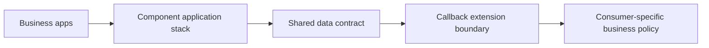

# Avoiding dependency cycles across shared rulesets

**PFA-022** | Pega SSA/LSA engineering study | Reference architecture, not yet lab-tested

## Incident that exposes the design

The Claims module builds on a shared Customer component, while Customer calls a Claims-specific verification rule. A new consumer application tries to reuse Customer and unexpectedly acquires Claims logic. The dependency graph is circular at the capability level even if the application builder allows the configured stack.

The architecture review must determine who owns the state, what survives retries, and whether the rule or infrastructure boundary actually enforces the expected behavior.

## Runtime path

## Pega-specific assets to inspect

1. **Built-on applications**. Establish the actual application/ruleset version, the responsible operator or runtime node, and where diagnostics for this component are captured.
2. **Ruleset prerequisites**. Establish the actual application/ruleset version, the responsible operator or runtime node, and where diagnostics for this component are captured.
3. **Data Page interfaces**. Establish the actual application/ruleset version, the responsible operator or runtime node, and where diagnostics for this component are captured.
4. **service contracts**. Establish the actual application/ruleset version, the responsible operator or runtime node, and where diagnostics for this component are captured.

## Reference implementation

1. Draw directed dependencies between applications and rulesets, including indirect rule references, not only built-on links.

2. Move shared data access into a neutral component that does not invoke consumer case rules.

3. Define an explicit extension contract when consumer policy must be called, with validation of class context and default behavior.

4. Package/release each component with declared prerequisite versions and a consumer compatibility suite.

5. Reject changes that make a lower-level utility depend directly on a higher-level implementation case.

## Decision and trade-off

- **Option 1:** Direct consumer callback inside shared component saves code but creates a cycle.
- **Option 2:** capability-level contract keeps reuse independent.

The selection belongs in an architecture decision record with affected system boundaries, non-functional acceptance criteria and an identified production owner.

## Failure diagnosis

Failure: upgrading one module requires upgrading every consuming app, or a utility rule resolves through the wrong application's override.

For a reproducible incident, retain the affected case or operation ID, timestamp, effective ruleset stack, requestor/node, downstream correlation ID where appropriate, and the actual failing transition. Never publish live client records or authorization tokens.

## Validation experiments

1. **Test 1:** Build graph and detect cycles. Record the precise input, expected outcome, observed server behavior and available evidence.
2. **Test 2:** run Customer component with Lending only. Record the precise input, expected outcome, observed server behavior and available evidence.
3. **Test 3:** upgrade Claims without modifying shared Customer. Record the precise input, expected outcome, observed server behavior and available evidence.

These are proposed verification experiments. No screenshot or performance result is presented as a completed run. Test on the actual installed Pega release, and record deviations from the pattern.

## Operations and production decision

Set operational alerts on the failure signal described above, not merely application health. Document how the team can retry, reconcile or repair the business transaction without duplicating remote effects. If deployment changes rules, schemas or identity policies, test active cases and queued operations crossing the release boundary.

## Documentation

- [Pega Academy: Application structure](https://academy.pega.com/topic/application-structure/v5)

*Independent technical design. Fictional scenario. Verify version-specific functionality in your own environment.*
