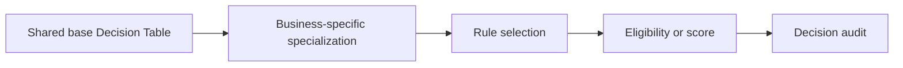

# Specialisation patterns without copying whole rules

**PFA-023** | Senior/Lead System Architect | Design case study, laboratory evidence pending

## The failure to prevent

A banking group copies an entire loan assessment Decision Table into twelve subsidiaries because each has a different affordability floor. Six versions then diverge on fraud exclusions that were intended to be universal.

The useful outcome is a repeatable design that remains correct across application variations, case versions and retries, not a single Dev Studio screen that happens to work.

## Execution and data boundaries

## Pega rules that must be considered

- **Rule-Decision-Table:** confirm the effective class, ruleset/app version and input/output contract for the specific business use case.
- **Circumstance rules:** confirm the effective class, ruleset/app version and input/output contract for the specific business use case.
- **ruleset/class inheritance:** confirm the effective class, ruleset/app version and input/output contract for the specific business use case.
- **PegaUnit:** confirm the effective class, ruleset/app version and input/output contract for the specific business use case.

## Detailed design sequence

1. Keep common mandatory exclusions in a single shared decision that consumers cannot bypass.

2. Expose a narrowly documented extension where country-level thresholds can vary without copying the whole rule.

3. Use class specialization for structurally different business processing and circumstancing for focused property/date variants, after checking rule-resolution order.

4. Define an explicit unknown-country default, avoiding implicit accept behavior.

5. Run a multi-application matrix that compares rule keys and business results across each implementing region.

A production-ready implementation should document the actual rule keys, test classes, authorized operators, system-of-record fields and accepted exception states. An external system's response should never be considered atomic with a Pega case commit without an explicit verified transaction model.

## Design alternatives

- **Pattern 1:** Copy whole table yields local ownership but excessive drift.
- **Pattern 2:** shared base and specialized threshold provide reuse but demand explicit precedence.

Select the pattern by testable business requirements: record ownership, controlled override scope, rollback of active cases, and failure recovery. An apparently easier class inheritance or flow design may have wider long-term maintenance cost.

## Diagnose the production failure

A copied table may lose a critical fix when only the base is changed; a circumstance property loaded from editable UI can select the wrong regime.

For a meaningful incident review, collect the effective ruleset list and precise selected rule, case history, assignments, node/requestor and trace of the failing execution. A screenshot of a rule form does not show which rule the case executed.

## Lab verification matrix

1. **Experiment 1:** Change common fraud flag and retest all subsidiaries. Save the input, expected business state, actual outcome and supporting trace.
2. **Experiment 2:** test overlapping circumstances. Save the input, expected business state, actual outcome and supporting trace.
3. **Experiment 3:** compare resolved rule versions. Save the input, expected business state, actual outcome and supporting trace.

These tests have not been executed for this article. Once run, add screenshots from a permitted Pega sandbox, with the actual version, reproduced steps and redacted identifiers.

## Release and operating guidance

Include negative cases and old active work in regression, particularly if a new ruleset or flow changes what can be resolved. Use a controlled change process for rules affecting authorization, eligibility or financial outcomes. Define who diagnoses an unresolved work item and how a safe retry is performed.

## Reference

- [Pega Academy: Ruleset specialization](https://academy.pega.com/topic/ruleset-class-and-circumstance-specialization/v3)

*Independent architectural design based on a fictional scenario. Validate platform-version details before implementation.*
