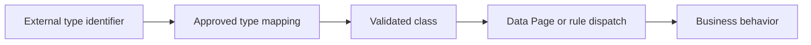

# Dynamic class referencing and long-term maintainability

**PFA-024** | Senior/Lead System Architect | Design case study, laboratory evidence pending

## The failure to prevent

A framework stores a class name from external JSON and uses it to select processing behavior. A partner introduces a new type whose value resembles an internal class path. The system can now resolve a rule in an unintended data class or fail after a refactor.

The useful outcome is a repeatable design that remains correct across application variations, case versions and retries, not a single Dev Studio screen that happens to work.

## Execution and data boundaries

## Pega rules that must be considered

- **Data Transform:** confirm the effective class, ruleset/app version and input/output contract for the specific business use case.
- **Value Group/decision mapping:** confirm the effective class, ruleset/app version and input/output contract for the specific business use case.
- **Class inheritance:** confirm the effective class, ruleset/app version and input/output contract for the specific business use case.
- **rule resolution:** confirm the effective class, ruleset/app version and input/output contract for the specific business use case.

## Detailed design sequence

1. Treat external type strings as untrusted business codes, not executable class names.

2. Maintain a versioned allowlist mapping partner codes to approved internal data classes and rule names.

3. Verify that target class and required properties implement the expected contract before dispatch.

4. Prefer explicit polymorphic rule behavior in a stable inheritance hierarchy rather than arbitrary class strings.

5. Create migration aliases when class refactoring changes a mapping, and monitor unmatched codes instead of silently falling back to generic behavior.

A production-ready implementation should document the actual rule keys, test classes, authorized operators, system-of-record fields and accepted exception states. An external system's response should never be considered atomic with a Pega case commit without an explicit verified transaction model.

## Design alternatives

- **Pattern 1:** Dynamic class paths provide flexibility but invite injection and refactoring brittleness.
- **Pattern 2:** explicit mapping has upkeep but safer bounded behavior.

Select the pattern by testable business requirements: record ownership, controlled override scope, rollback of active cases, and failure recovery. An apparently easier class inheritance or flow design may have wider long-term maintenance cost.

## Diagnose the production failure

A legacy integration code resolves to the wrong inherited rule after framework changes; an unrecognized partner type falls back to privileged processing.

For a meaningful incident review, collect the effective ruleset list and precise selected rule, case history, assignments, node/requestor and trace of the failing execution. A screenshot of a rule form does not show which rule the case executed.

## Lab verification matrix

1. **Experiment 1:** Send unknown class-like code and expect rejection. Save the input, expected business state, actual outcome and supporting trace.
2. **Experiment 2:** rename an implementation class and test migration. Save the input, expected business state, actual outcome and supporting trace.
3. **Experiment 3:** test two subclasses with different property sets. Save the input, expected business state, actual outcome and supporting trace.

These tests have not been executed for this article. Once run, add screenshots from a permitted Pega sandbox, with the actual version, reproduced steps and redacted identifiers.

## Release and operating guidance

Include negative cases and old active work in regression, particularly if a new ruleset or flow changes what can be resolved. Use a controlled change process for rules affecting authorization, eligibility or financial outcomes. Define who diagnoses an unresolved work item and how a safe retry is performed.

## Reference

- [Pega Academy: Rule resolution](https://academy.pega.com/topic/rule-resolution/v7)

*Independent architectural design based on a fictional scenario. Validate platform-version details before implementation.*
