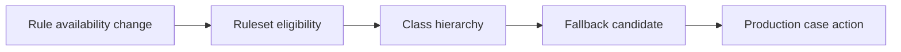

# Rule availability and production rollback constraints

**PFA-025** | Senior/Lead System Architect | Design case study, laboratory evidence pending

## The failure to prevent

An operations team marks a malfunctioning rule Withdrawn during incident response, intending to disable it. A different eligible older rule then resolves, recreating an obsolete approval path. Blocked, Withdrawn and Not Available are not interchangeable rollback switches.

The useful outcome is a repeatable design that remains correct across application variations, case versions and retries, not a single Dev Studio screen that happens to work.

## Execution and data boundaries

## Pega rules that must be considered

- **Rule availability:** confirm the effective class, ruleset/app version and input/output contract for the specific business use case.
- **Ruleset version:** confirm the effective class, ruleset/app version and input/output contract for the specific business use case.
- **Rule resolution cache:** confirm the effective class, ruleset/app version and input/output contract for the specific business use case.
- **Deployment Manager:** confirm the effective class, ruleset/app version and input/output contract for the specific business use case.

## Detailed design sequence

1. Document the exact semantics of Available, Final, Not Available, Withdrawn and Blocked for the deployed release before changing flags.

2. For each critical rule, identify the complete candidate chain and the behavior of the next eligible rule.

3. Prefer an explicit fixed product rollback for coherent business functionality, not a series of ad-hoc availability edits.

4. Test long-running cases and background requestors separately because their application contexts can differ.

5. Record an emergency change request linking availability modifications to outcome tests and a plan to restore normal version control.

A production-ready implementation should document the actual rule keys, test classes, authorized operators, system-of-record fields and accepted exception states. An external system's response should never be considered atomic with a Pega case commit without an explicit verified transaction model.

## Design alternatives

- **Pattern 1:** Availability flags provide targeted behavior changes but risky fallback.
- **Pattern 2:** full release rollback is more coherent but cannot reverse data changes.

Select the pattern by testable business requirements: record ownership, controlled override scope, rollback of active cases, and failure recovery. An apparently easier class inheritance or flow design may have wider long-term maintenance cost.

## Diagnose the production failure

Withdrawing an implementation rule can expose a more generic decision that omits an important control. Marking a rule Blocked may prevent expected fallback; capture actual trace.

For a meaningful incident review, collect the effective ruleset list and precise selected rule, case history, assignments, node/requestor and trace of the failing execution. A screenshot of a rule form does not show which rule the case executed.

## Lab verification matrix

1. **Experiment 1:** Mark test candidate Withdrawn and record fallback. Save the input, expected business state, actual outcome and supporting trace.
2. **Experiment 2:** mark blocked candidate and test execution. Save the input, expected business state, actual outcome and supporting trace.
3. **Experiment 3:** resume old assignment after rollback. Save the input, expected business state, actual outcome and supporting trace.

These tests have not been executed for this article. Once run, add screenshots from a permitted Pega sandbox, with the actual version, reproduced steps and redacted identifiers.

## Release and operating guidance

Include negative cases and old active work in regression, particularly if a new ruleset or flow changes what can be resolved. Use a controlled change process for rules affecting authorization, eligibility or financial outcomes. Define who diagnoses an unresolved work item and how a safe retry is performed.

## Reference

- [Pega Academy: Rule availability](https://academy.pega.com/topic/rule-resolution/v7)

*Independent architectural design based on a fictional scenario. Validate platform-version details before implementation.*
