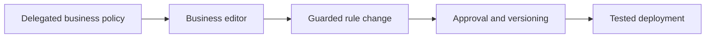

# Delegated business rules with architectural boundaries

**PFA-026** | Senior/Lead System Architect | Design case study, laboratory evidence pending

## The failure to prevent

Business managers must update underwriting bands quarterly without developer involvement. An administrator delegates broad rule editing rights, allowing unreviewed changes that alter regulated eligibility as well as thresholds.

The useful outcome is a repeatable design that remains correct across application variations, case versions and retries, not a single Dev Studio screen that happens to work.

## Execution and data boundaries

## Pega rules that must be considered

- **Delegated Decision Table:** confirm the effective class, ruleset/app version and input/output contract for the specific business use case.
- **Access Roles:** confirm the effective class, ruleset/app version and input/output contract for the specific business use case.
- **rule delegation:** confirm the effective class, ruleset/app version and input/output contract for the specific business use case.
- **PegaUnit:** confirm the effective class, ruleset/app version and input/output contract for the specific business use case.
- **release approvals:** confirm the effective class, ruleset/app version and input/output contract for the specific business use case.

## Detailed design sequence

1. Delegate only the specific decision rule and fields whose semantics business owners are authorized to change.

2. Freeze structural logic, mandatory eligibility exclusions and technical integrations under engineering control.

3. Define peer review and effective date governance; a rule editable by business still needs a controlled publishing process.

4. Provide predefined edge-case test fixtures that run after any value change, including limit boundaries and disallowed applicants.

5. Audit who changed a cell, rule version, approval and rollback artifact, and measure outcomes after release.

A production-ready implementation should document the actual rule keys, test classes, authorized operators, system-of-record fields and accepted exception states. An external system's response should never be considered atomic with a Pega case commit without an explicit verified transaction model.

## Design alternatives

- **Pattern 1:** Full developer-managed policy slows routine changes.
- **Pattern 2:** unrestricted delegation creates governance and audit gaps.

Select the pattern by testable business requirements: record ownership, controlled override scope, rollback of active cases, and failure recovery. An apparently easier class inheritance or flow design may have wider long-term maintenance cost.

## Diagnose the production failure

A business update shifts an inequality from less-than to less-than-or-equal, causing wrong boundary treatment; a copied delegated rule can shadow the shared base.

For a meaningful incident review, collect the effective ruleset list and precise selected rule, case history, assignments, node/requestor and trace of the failing execution. A screenshot of a rule form does not show which rule the case executed.

## Lab verification matrix

1. **Experiment 1:** Edit approved threshold within limits. Save the input, expected business state, actual outcome and supporting trace.
2. **Experiment 2:** attempt forbidden structural edit. Save the input, expected business state, actual outcome and supporting trace.
3. **Experiment 3:** replay boundary test suite before approval. Save the input, expected business state, actual outcome and supporting trace.

These tests have not been executed for this article. Once run, add screenshots from a permitted Pega sandbox, with the actual version, reproduced steps and redacted identifiers.

## Release and operating guidance

Include negative cases and old active work in regression, particularly if a new ruleset or flow changes what can be resolved. Use a controlled change process for rules affecting authorization, eligibility or financial outcomes. Define who diagnoses an unresolved work item and how a safe retry is performed.

## Reference

- [Pega Academy: Rule resolution](https://academy.pega.com/topic/rule-resolution/v7)

*Independent architectural design based on a fictional scenario. Validate platform-version details before implementation.*
