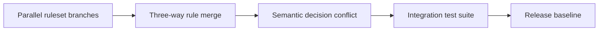

# Branch conflicts in high-churn decision tables

**PFA-027** | Senior/Lead System Architect | Design case study, laboratory evidence pending

## The failure to prevent

Five branches change the same high-traffic Decision Table. Each tests in isolation. Merge succeeds mechanically, but one team's affordability condition now masks another team's vulnerability exclusion.

The useful outcome is a repeatable design that remains correct across application variations, case versions and retries, not a single Dev Studio screen that happens to work.

## Execution and data boundaries

## Pega rules that must be considered

- **Decision Table:** confirm the effective class, ruleset/app version and input/output contract for the specific business use case.
- **branch ruleset:** confirm the effective class, ruleset/app version and input/output contract for the specific business use case.
- **application version:** confirm the effective class, ruleset/app version and input/output contract for the specific business use case.
- **PegaUnit:** confirm the effective class, ruleset/app version and input/output contract for the specific business use case.

## Detailed design sequence

1. Avoid long-lived divergent branches for centrally shared policy rules; assign short ownership windows where practical.

2. Capture baseline, changed rows and rule conditions for each contributor; a no-text-conflict merge does not imply semantic compatibility.

3. Test overlapping conditions, fallback rows and decision ordering as first-class business behavior.

4. Promote only after the integrated ruleset passes cross-team PegaUnit and full case regression using realistic conditions.

5. Use a change calendar for delegated high-risk tables and publish the resolved rule key as release evidence.

A production-ready implementation should document the actual rule keys, test classes, authorized operators, system-of-record fields and accepted exception states. An external system's response should never be considered atomic with a Pega case commit without an explicit verified transaction model.

## Design alternatives

- **Pattern 1:** Fast parallel delivery optimizes developer throughput.
- **Pattern 2:** single-owner merge gate lowers risk of silent logic override.

Select the pattern by testable business requirements: record ownership, controlled override scope, rollback of active cases, and failure recovery. An apparently easier class inheritance or flow design may have wider long-term maintenance cost.

## Diagnose the production failure

Two new rows can overlap and the first match silently wins; independent tests never exercise their intersection.

For a meaningful incident review, collect the effective ruleset list and precise selected rule, case history, assignments, node/requestor and trace of the failing execution. A screenshot of a rule form does not show which rule the case executed.

## Lab verification matrix

1. **Experiment 1:** Construct input meeting both merged predicates. Save the input, expected business state, actual outcome and supporting trace.
2. **Experiment 2:** verify fallback and order. Save the input, expected business state, actual outcome and supporting trace.
3. **Experiment 3:** test resulting artifact outside branch context. Save the input, expected business state, actual outcome and supporting trace.

These tests have not been executed for this article. Once run, add screenshots from a permitted Pega sandbox, with the actual version, reproduced steps and redacted identifiers.

## Release and operating guidance

Include negative cases and old active work in regression, particularly if a new ruleset or flow changes what can be resolved. Use a controlled change process for rules affecting authorization, eligibility or financial outcomes. Define who diagnoses an unresolved work item and how a safe retry is performed.

## Reference

- [Pega Academy: Rule resolution](https://academy.pega.com/topic/rule-resolution/v7)

*Independent architectural design based on a fictional scenario. Validate platform-version details before implementation.*
