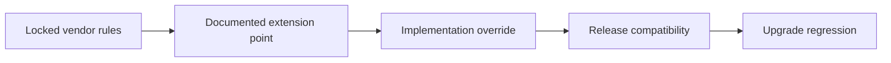

# Safe customization of locked product extensions

**PFA-028** | Senior/Lead System Architect | Design case study, laboratory evidence pending

## The failure to prevent

A team needs a Pega platform UI extension unavailable in a locked product ruleset. They attempt to modify a Final vendor rule or copy entire internal sections. The solution passes today but becomes incompatible with an upgrade.

The useful outcome is a repeatable design that remains correct across application variations, case versions and retries, not a single Dev Studio screen that happens to work.

## Execution and data boundaries

## Pega rules that must be considered

- **Rule status Final:** confirm the effective class, ruleset/app version and input/output contract for the specific business use case.
- **Class specialization:** confirm the effective class, ruleset/app version and input/output contract for the specific business use case.
- **component extension:** confirm the effective class, ruleset/app version and input/output contract for the specific business use case.
- **Application stack:** confirm the effective class, ruleset/app version and input/output contract for the specific business use case.

## Detailed design sequence

1. Identify a supported extension point or delegated hook before bypassing locked platform artifacts.

2. Avoid copying large out-of-the-box rules; keep a small independent extension with a stable contract and justification.

3. Where overriding is supported, record the precise apply-to class, ruleset precedence and expected chosen rule version.

4. Put all unsupported dependencies into a separate risk register with ownership and an exit strategy.

5. Validate the extension against the target version and supported compatibility documentation before every platform upgrade.

A production-ready implementation should document the actual rule keys, test classes, authorized operators, system-of-record fields and accepted exception states. An external system's response should never be considered atomic with a Pega case commit without an explicit verified transaction model.

## Design alternatives

- **Pattern 1:** Supported extension preserves upgrade path.
- **Pattern 2:** copying internal vendor rules may work but creates high regression and support risk.

Select the pattern by testable business requirements: record ownership, controlled override scope, rollback of active cases, and failure recovery. An apparently easier class inheritance or flow design may have wider long-term maintenance cost.

## Diagnose the production failure

A framework upgrade changes an internal property used by copied rules and only a specific case variant fails. The absence of initial errors is not compatibility evidence.

For a meaningful incident review, collect the effective ruleset list and precise selected rule, case history, assignments, node/requestor and trace of the failing execution. A screenshot of a rule form does not show which rule the case executed.

## Lab verification matrix

1. **Experiment 1:** Upgrade target rule version in test. Save the input, expected business state, actual outcome and supporting trace.
2. **Experiment 2:** remove extension and verify baseline behavior. Save the input, expected business state, actual outcome and supporting trace.
3. **Experiment 3:** replay critical case journey. Save the input, expected business state, actual outcome and supporting trace.

These tests have not been executed for this article. Once run, add screenshots from a permitted Pega sandbox, with the actual version, reproduced steps and redacted identifiers.

## Release and operating guidance

Include negative cases and old active work in regression, particularly if a new ruleset or flow changes what can be resolved. Use a controlled change process for rules affecting authorization, eligibility or financial outcomes. Define who diagnoses an unresolved work item and how a safe retry is performed.

## Reference

- [Pega Academy: Rule availability](https://academy.pega.com/topic/rule-resolution/v7)

*Independent architectural design based on a fictional scenario. Validate platform-version details before implementation.*
