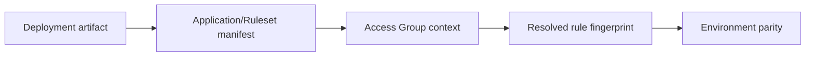

# Detecting application stack drift across environments

**PFA-029** | Senior/Lead System Architect | Design case study, laboratory evidence pending

## The failure to prevent

An application passes UAT yet routes cases differently after production release. Dev, test and production have subtly different access-group application versions and a manually deployed shared ruleset.

The useful outcome is a repeatable design that remains correct across application variations, case versions and retries, not a single Dev Studio screen that happens to work.

## Execution and data boundaries

## Pega rules that must be considered

- **Application definition:** confirm the effective class, ruleset/app version and input/output contract for the specific business use case.
- **Ruleset list:** confirm the effective class, ruleset/app version and input/output contract for the specific business use case.
- **Rule-Admin-Product:** confirm the effective class, ruleset/app version and input/output contract for the specific business use case.
- **PegaUnit:** confirm the effective class, ruleset/app version and input/output contract for the specific business use case.

## Detailed design sequence

1. Export a deterministic release manifest containing application version, built-on stack and ruleset list from each environment.

2. Do not compare only the count of rules. Include effective operator access groups and headless worker contexts.

3. Package required dependencies into an immutable product, with explicit migration and configuration changes.

4. Add a deployment gate that executes a representative rule resolution trace and compares chosen rule keys between pre-production and production candidate.

5. Separate intended environmental endpoint settings from forbidden ruleset drift; document approved exceptions.

A production-ready implementation should document the actual rule keys, test classes, authorized operators, system-of-record fields and accepted exception states. An external system's response should never be considered atomic with a Pega case commit without an explicit verified transaction model.

## Design alternatives

- **Pattern 1:** Manual emergency hotfixes are quick but produce hidden drift.
- **Pattern 2:** artifact-driven release gates reduce surprises.

Select the pattern by testable business requirements: record ownership, controlled override scope, rollback of active cases, and failure recovery. An apparently easier class inheritance or flow design may have wider long-term maintenance cost.

## Diagnose the production failure

A production operator resolves a previous version of the same decision because its application definition was not updated.

For a meaningful incident review, collect the effective ruleset list and precise selected rule, case history, assignments, node/requestor and trace of the failing execution. A screenshot of a rule form does not show which rule the case executed.

## Lab verification matrix

1. **Experiment 1:** Compare manifests across dev and UAT. Save the input, expected business state, actual outcome and supporting trace.
2. **Experiment 2:** alter one access group version and detect drift. Save the input, expected business state, actual outcome and supporting trace.
3. **Experiment 3:** run critical decision under worker context. Save the input, expected business state, actual outcome and supporting trace.

These tests have not been executed for this article. Once run, add screenshots from a permitted Pega sandbox, with the actual version, reproduced steps and redacted identifiers.

## Release and operating guidance

Include negative cases and old active work in regression, particularly if a new ruleset or flow changes what can be resolved. Use a controlled change process for rules affecting authorization, eligibility or financial outcomes. Define who diagnoses an unresolved work item and how a safe retry is performed.

## Reference

- [Pega Academy: Ruleset list](https://academy.pega.com/topic/ruleset-list/v6)

*Independent architectural design based on a fictional scenario. Validate platform-version details before implementation.*
