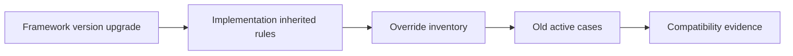

# Upgrading frameworks without breaking implementation rules

**PFA-030** | Senior/Lead System Architect | Design case study, laboratory evidence pending

## The failure to prevent

A multinational claims framework adds a new validation to a base case. Subsidiary implementations override the old flow and never execute it. The framework upgrade is technically successful but creates inconsistent controls.

The useful outcome is a repeatable design that remains correct across application variations, case versions and retries, not a single Dev Studio screen that happens to work.

## Execution and data boundaries

## Pega rules that must be considered

- **Built-on application:** confirm the effective class, ruleset/app version and input/output contract for the specific business use case.
- **rule overrides:** confirm the effective class, ruleset/app version and input/output contract for the specific business use case.
- **case flow:** confirm the effective class, ruleset/app version and input/output contract for the specific business use case.
- **PegaUnit regression:** confirm the effective class, ruleset/app version and input/output contract for the specific business use case.

## Detailed design sequence

1. Inventory every implementation override of changed framework rules, including circumstances and blocked candidates.

2. For each common policy addition, determine whether the extension mechanism guarantees that implementation cases execute it.

3. Build a semantic regression matrix that runs shared rules across all subsidiaries with their actual class and ruleset stack.

4. Test persisted cases created before the framework release as well as fresh case creation.

5. Publish implementation compatibility requirements and retire duplicated rules that no longer intentionally differ.

A production-ready implementation should document the actual rule keys, test classes, authorized operators, system-of-record fields and accepted exception states. An external system's response should never be considered atomic with a Pega case commit without an explicit verified transaction model.

## Design alternatives

- **Pattern 1:** Copy-and-override offers flexibility but can skip future controls.
- **Pattern 2:** stable framework extension points preserve governance but constrain implementation design.

Select the pattern by testable business requirements: record ownership, controlled override scope, rollback of active cases, and failure recovery. An apparently easier class inheritance or flow design may have wider long-term maintenance cost.

## Diagnose the production failure

A new fraud check is added only to the base Flow rule, while a country-specific copied Flow keeps the old version.

For a meaningful incident review, collect the effective ruleset list and precise selected rule, case history, assignments, node/requestor and trace of the failing execution. A screenshot of a rule form does not show which rule the case executed.

## Lab verification matrix

1. **Experiment 1:** Run affected case in base and three subclasses. Save the input, expected business state, actual outcome and supporting trace.
2. **Experiment 2:** replay open case under new stack. Save the input, expected business state, actual outcome and supporting trace.
3. **Experiment 3:** trace eligibility rule for each. Save the input, expected business state, actual outcome and supporting trace.

These tests have not been executed for this article. Once run, add screenshots from a permitted Pega sandbox, with the actual version, reproduced steps and redacted identifiers.

## Release and operating guidance

Include negative cases and old active work in regression, particularly if a new ruleset or flow changes what can be resolved. Use a controlled change process for rules affecting authorization, eligibility or financial outcomes. Define who diagnoses an unresolved work item and how a safe retry is performed.

## Reference

- [Pega Academy: Application structure](https://academy.pega.com/topic/application-structure/v5)

*Independent architectural design based on a fictional scenario. Validate platform-version details before implementation.*
