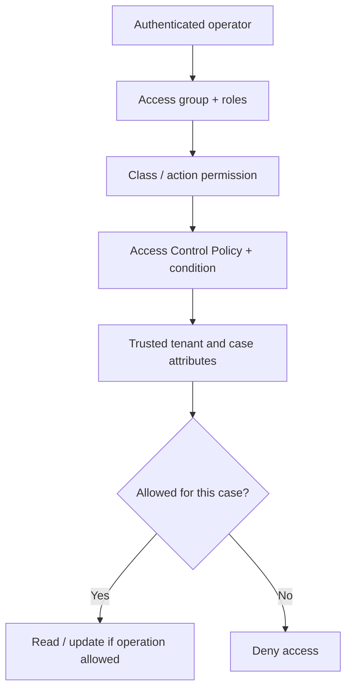

# RBAC and ABAC Together: Closing the Customer Record Isolation Gap

**PFA-138** | **Audience:** Senior and Lead System Architects | **Status:** Reference architecture; live Pega test pending

A caseworker has permission to open a claim class, but is not entitled to every claim in that class. That is the point where role permissions alone become insufficient.

## 1. The enterprise failure this design prevents

A contact centre operator can open and update claims. The organisation has multiple corporate clients, each with a separate book of cases. The user belongs to Client A's service team, but a direct case ID belonging to Client B is pasted into a link. The Pega operator has an access role permitting read on the claim class. That role is necessary but does not establish permission for every object. A robust design combines **role-based access** with **attribute-based record restrictions** and a trusted tenant context.

## 2. Component and execution architecture

The following diagram is an **illustrative reference design**. It is not a screenshot from a running Pega environment.

## 3. Which Pega objects own each concern?

| Component | Why it exists |
|---|---|
| `Access Role to Object (ARO)` | Class-level permissions such as read, write and delete |
| `Privilege` | Grant specific operations requiring explicit privilege |
| `Access Control Policy` | Apply object-level read/update/delete restrictions as supported |
| `Access Control Policy Condition` | Compare relevant record and trusted context attributes |
| `Claim .TenantID` | Immutable or tightly governed case ownership attribute |
| `Operator security context` | Derive effective tenant scope from trusted identity/entitlements |

The named objects above are a mix of actual Pega rule categories and illustrative application-specific names. They are not a claim that all such rules exist in a default Pega installation.

## 4. Implementation design and decision sequence

1. Define the protected objects and operations. A list/search read, direct open, update, export and background case action need separate threat scenarios.

2. Grant the operator's role the minimum class operations it genuinely needs. Pega RBAC uses access roles and ARO records; privileges protect specific rule operations.

3. Introduce an Access Control Policy on the relevant Work- or Data- class with a condition linked to trusted tenant/customer entitlements.

4. Ensure the tenant identifier on a case cannot be modified through ordinary user input. Treat user-supplied Case ID or UI parameters as untrusted.

5. Enforce authorization at every access path: portal, search/report, REST service, batch job and background processing. Validate the supported behaviour for each query/source type.

6. Test record read and update separately; allowing read may not imply update. Check whether an indexed related class is needed for complex policy conditions.

7. Capture the deployed access policy version. Pega documentation notes that access control policy changes do not take effect from checked-out rules until checked in.

## 5. What an architect must choose

| Approach | Effect and trade-off |
|---|---|
| Role-only authorization | Simple for broad functional permissions, insufficient for per-tenant row restrictions |
| Role + ABAC condition | Fits dynamic record ownership but requires verified policy applicability to all access paths |
| Tenant-segregated apps or physical data | Stronger isolation opportunities at higher implementation and operating cost |

**Decision standard:** choose the smallest design that satisfies consistency, auditability, security, performance and operational recovery, not the design that simply looks easiest in Dev Studio.

## 6. Failure modes and root-cause investigation

**ID enumeration:** users can guess another case ID through a service that lacks enforcement. **Report leakage:** an export path bypasses the intended UI filter; test effective ABAC on the actual query. **Mutable TenantID:** the actor updates a property before authorization is evaluated. **Background overprivilege:** a system access group reads all tenants without constraining operation scope. **Cache reuse:** a requestor sees data retrieved under earlier entitlements. None of these is addressed by hiding a field in the browser.

For troubleshooting, preserve the application/ruleset version, access context, precise business identity, timestamp and correlation ID. Never include secrets or production customer documents in publicly shared traces.

## 7. Verification matrix for a Pega lab

These are **tests to run**, not tests that have already passed.

| Experiment | Evidence and expected assertion |
|---|---|
| Direct open | Client A agent opens Client B case ID; must be denied |
| Search/report | Client B records must not appear in count or export under Client A context |
| Update | Client A cannot update a Client B record even if its ID is supplied |
| Privilege | A low-privilege agent cannot run a protected high-risk flow |
| Identity revocation | Remove a client's entitlement and test access with active session |
| Background | Run scheduler/integration under scoped access group and inspect data access |

At the end of the experiment, attach redacted screenshots of the relevant rule forms, Clipboard/Tracer/PAL evidence when applicable, and an actual observed outcome. If any result differs, update the design instead of changing the evidence description.

## 8. Production readiness and ownership

Treat security test results as release evidence. Audit privilege and policy changes. Monitor rejected access attempts by purpose and operator, while minimising stored sensitive content. Validate actual rule behaviour in the target Pega version before relying on a policy for regulated tenant boundaries.

**Architecture acceptance:** the design has an explicit owner, a version-specific reproducible test, a failure/recovery procedure, the relevant security controls and a way to detect regressions.

## 9. Product references and limitations

- [Pega Academy: Role-based access control](https://academy.pega.com/topic/role-based-access-control-rbac/v7)
- [Pega Academy: Creating access control policy](https://academy.pega.com/topic/creating-access-control-policy/v2/in/24621)
- [Pega Academy: Policy conditions](https://academy.pega.com/topic/creating-access-control-policy-condition/v2/in/24621)

Pega functionality changes by release. Treat exact editor labels, extension points and service behaviours as version-sensitive until verified in the target environment. This independent article is neither an official Pega document nor a claim of an executed customer implementation.
