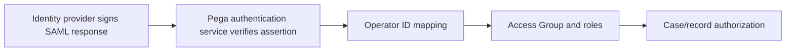

# SAML SSO: When Authentication Succeeds but the Wrong Pega Application Opens

**PFA-136** | Senior / Lead System Architect level | Design reference, not a lab result

## The practical failure

An operator authenticates through the corporate identity provider, but lands in a wider operations application than their current role allows. The SAML assertion may be valid while the mapping to Operator ID and Access Group is wrong. Federation verifies identity; authorisation still depends on the actual Pega access model and case permissions.

## Technical flow

The diagram describes a proposed execution boundary rather than a captured Pega implementation.

## Pega rules and interfaces involved

| Rule or component | Architect's checklist |
|---|---|
| Authentication Service | Owns one part of this design |
| Operator ID security settings | Requires clear data and security contract |
| Access Group | Needs actual release-specific configuration |
| Access Role to Object permissions | Should yield evidence for diagnostics |
| Access Control Policy for sensitive records | Has a testable operational responsibility |

## Implementation design

1. Design a stable identity mapping key and a process for renamed users. Avoid treating mutable display names as the unique operator identity.

2. Validate signature, issuer, audience and validity windows; plan metadata and signing certificate rollover.

3. Map incoming group/role context to the intended Operator ID and Access Group. Explicitly handle identities entitled to multiple applications.

4. Separate function permission through access roles from record-level policy; a successful SSO event must never grant all customer data.

5. Secure Service REST, Queue Processor and scheduled jobs under their own machine contexts rather than assuming browser SSO protects every entry point.

6. Test role transfer, revoked identity access, session expiry, emergency privileges and default access-group fallback.

7. Publish an authentication failure runbook that correlates IdP event metadata with Pega selected operator and access context.

## Competing patterns

| Approach | Trade-off |
|---|---|
| One default access group for everyone | Low maintenance but overly broad authorization |
| Role-aware access-group selection | Better separation, needs robust attribute mapping and testing |
| Custom authentication logic everywhere | High risk of drift and inconsistent security |

A valid architecture makes the consistency, permission and recovery contract explicit. Do not optimize for one successful demonstration while ignoring the retry or failure case.

## Why it breaks in production

Certificate rollover and stale identity assertions cause login errors. A stale access group assignment causes an apparently successful login with excessive privileges. Users may retain sessions after IdP revocation until the configured Pega session controls expire. Record redacted assertion metadata, not raw personal claims.

For incident triage, retain a redacted operation/case ID, node, ruleset/app version, timestamp and evidence of the dependent system. Never publish private client payloads or authentication tokens.

## Reproduction and verification plan

| Scenario | Evidence to obtain |
|---|---|
| Test 1 | Log in with a single-role identity and verify its effective application. |
| Test 2 | Test a multi-role user and confirm the least-privileged intended context. |
| Test 3 | Disable the IdP account during a session and verify revocation policy. |
| Test 4 | Rotate signing certificate in pre-production and validate the transition. |

These are proposed tests. No claim is made that the scenario has been executed in a Pega lab. A complete validated edition should show the actual Pega rule forms, configuration values and observed result for the target release.

## Release checklist

Record system of record, data and authorization boundary, expected volume, timeout/retry or conflict strategy, owner of failures, migration impact and a repair runbook. Confirm behavior across at least two realistic user/role contexts where applicable.

## Source and version note

- [Relevant Pega Academy reference](https://academy.pega.com/topic/authentication-design-considerations/v5/in/65751)

Independent original engineering content. Version-specific editor names and configuration controls must be checked against the Pega release used by the reader.
